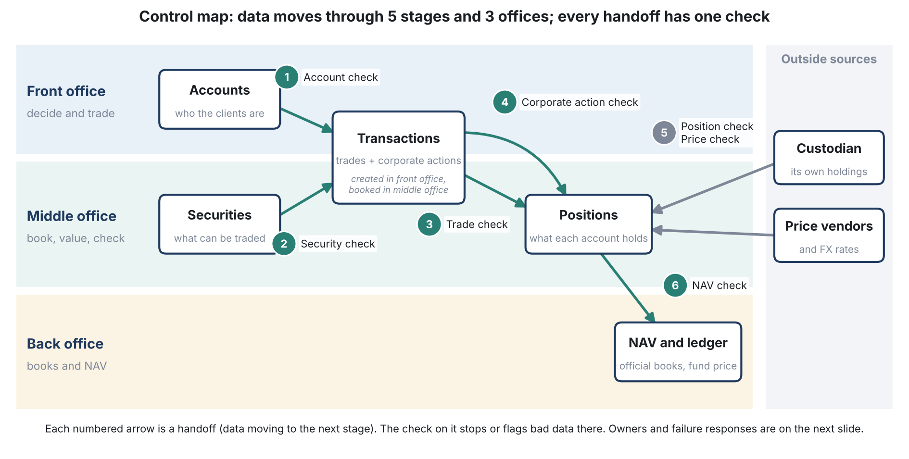
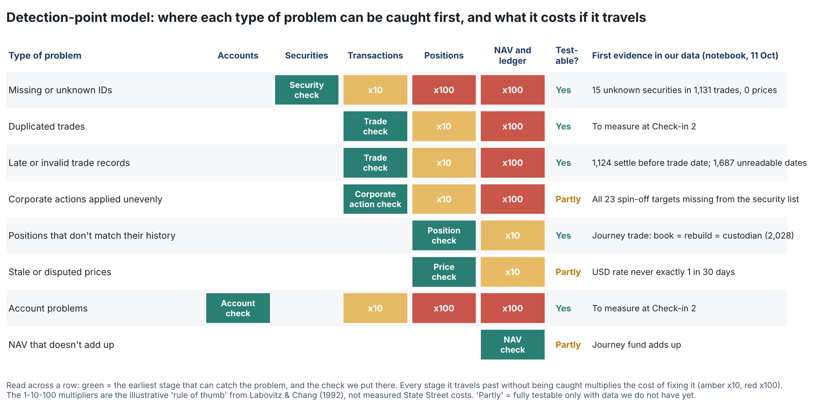
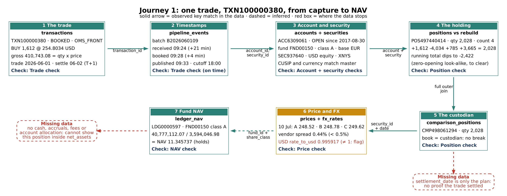

# Catch It Where It Enters

**Data quality in a front-to-back fund platform · Check-in 1 report**

*State Street case · BC Fall into BC Case Competition 2026 · 12 October 2026*

---

## Summary

A fund platform turns millions of trades into one number that investors rely on every day: the price of a fund share, the **NAV**. That number is only as good as the data that reaches it. Data passes through three offices (front, middle and back) and five stages, and at every **handoff** it can be dropped, duplicated, delayed or changed. A problem that is not caught where it enters becomes a wrong holding, then a wrong valuation, then a wrong fund price, and fixing it gets more expensive at every step.

Our approach is simple: **put one check at every handoff, give each check one owner and one clear response, and measure how often each office's data passes.** That gives 6 handoffs, 7 checks, 7 KPIs and 6 testable promises between offices.

We already tested the design on the supplied data. Our main finding: **spin-offs created 15 new securities that were never set up in the security list. They were still traded (1,131 trades) and held (1,118 positions), and none of them has a price**, so nobody can value those holdings. A security check at the point where the security list feeds the trades would have stopped every one of those trades.

---

## 1. The business problem

### 1.1 How a fund platform works

An investment fund pools money from many investors. Each day it publishes the value of one fund share: the **net asset value (NAV) per share**, equal to the fund's assets minus its liabilities, divided by the number of shares. Investors buy and sell the fund at that price.

Three offices handle the data on the way to that price:

| Office | Who | What they do |
|---|---|---|
| **Front office** | Portfolio managers and traders | Decide what to buy and sell, and create the trade |
| **Middle office** | Trade operations, pricing and reconciliation analysts | Book the trade, value every holding, and compare our records with the custodian's |
| **Back office** | Fund accountants | Keep the official books and calculate the NAV |

Two outside sources feed the platform: the **custodian** (the bank that holds the assets and keeps its own record of what each account owns) and the **price vendors and FX provider** (daily prices and currency rates).

### 1.2 Where it breaks, and why it matters

Every time data moves from one stage to the next, it can be:

- **dropped:** a trade never arrives
- **duplicated:** the same trade is booked twice
- **delayed:** it misses the deadline for today's NAV
- **changed:** a wrong price, security or date

A simple example (illustrative numbers). A fund holds $10,000 of stock and has 1,000 shares, so its NAV is $10.00. A $5,000 purchase is booked twice. The fund now thinks it holds $15,000, and the NAV becomes $15.00. Anyone who buys the fund that day pays 50% too much.

The later a problem is caught, the more it costs. A common rule of thumb (Labovitz and Chang, 1992) is that preventing a bad record costs 1, correcting it later costs 10, and letting it cause a failure costs 100. The numbers are illustrative; the shape of the argument is the point.

### 1.3 Why this is State Street's business

State Street is one of the world's largest custodian and asset-servicing banks, with a record **$57.9 trillion** in assets under custody and/or administration in Q2 2026. It offers *"a full range of back-, middle- and front-office solutions, including custody, accounting and fund administration"* and, through **State Street Alpha**, a front-to-back platform that runs from the front-office software (Charles River) to fund accounting. When one provider runs several handoffs, it can move checks upstream, and a problem that crosses offices becomes its own cost. Settlement is also getting faster (the US moved to one-day settlement, T+1, in May 2024), which leaves less time to catch a bad record.

*These are public facts used as context, not claims about State Street's internal systems.*

---

## 2. What the competition asks

The brief has two parts:

- **Part One, the architecture** (Check-in 1, today): where checks sit, who owns them, what we measure, and what happens when a problem is found.
- **Part Two, the demonstration** (Check-ins 2 and 3, final in November): code that loads the full data (100,000 accounts, 1.4 million trades), finds real problems, traces them to where they entered, and shows a dashboard.

For Check-in 1 the brief asks for seven pieces. Each has a section below and a slide in our deck.

| Brief asks for | This report | Slide |
|---|---|---|
| Lifecycle and control map | 3.1, 3.2 | 3, 4 |
| Detection-point model (the core of Part One) | 3.3 | 5 |
| End-to-end journey of a trade and a master record | 3.4 | 6, 7 |
| KPIs by office | 3.5 | 8 |
| Data contracts between offices | 3.6 | 9 |
| Operating model and maturity path | 3.7 | 10 |

---

## 3. Our approach

### 3.1 The control map: five stages, three offices, six handoffs

Data moves through the five stages the brief names: **Accounts, Securities, Transactions, Positions, NAV and ledger.** Accounts and securities are the **master data**, the reference lists of *who* and *what* that everything else looks up. We place each stage in the office that owns it and mark the six handoffs where data moves on.

| # | Handoff | What must hold |
|---|---|---|
| 1 | Account list → trades | Every trade belongs to a known, open account |
| 2 | Security list → trades | Every trade and corporate action uses a known security |
| 3 | Trades → positions | Booked trades, on time, add up to each holding |
| 4 | Corporate actions → positions | Events such as splits and spin-offs adjust every holder correctly |
| 5 | Custodian and prices → positions | The custodian confirms quantities; vendors give prices and FX rates |
| 6 | Positions → fund NAV | Valued holdings roll up into each fund and share class |

### 3.2 The seven checks

Each handoff has one check (handoff 5 has two, one for each outside source). Every check says what it tests, what happens when it fails, and which role owns it. Owners are roles, never people's names.

| Check | What it tests | If it fails | Owner |
|---|---|---|---|
| Account check | The account exists, is open on the trade date, and has a fund and share class | Hold the trade | Account onboarding lead |
| Security check | The security exists in the security list; the trade's code and currency match | Hold the trade | Security master lead |
| Trade check | No duplicates; required fields filled; dates readable; settles within 2 business days unless agreed; booked before cutoff | Reject, or hold for review | Trade operations lead |
| Corporate action check | Before the ex-date: terms complete for the event type; any new security already set up | Quarantine the event | Corporate actions lead |
| Position check | Each holding equals the sum of its trades and matches the custodian | Flag a break and work it | Reconciliation lead |
| Price check | A price from today; the three vendors agree within 0.5%; a valid FX rate | Use the next vendor, or flag | Pricing lead |
| NAV check | Net assets / shares = NAV; no serious open problem feeds the fund | Hold the NAV | Fund accounting lead |

Six of the seven checks are **preventive**: they stop bad data before it moves. The position check is **detective**: it finds differences after the fact, because the custodian's record only arrives afterwards.

### 3.3 The detection-point model

For each type of problem, the brief asks for the earliest stage that could catch it, the evidence that needs, and the consequence of missing it. We cover the six problem families the brief names, plus account problems and NAV arithmetic.

How to read a row: *missing or unknown IDs* (for example, a trade that uses a security we do not know) can be caught at the **Securities** stage by the **security check**. If it slips into the trades, the cost multiplies by 10; once it reaches positions and the NAV, by 100, because every holder of that security is now wrong.

Two of the eight problem types are only **partly** testable with the data we have. We name the missing data in section 3.6 instead of guessing.

### 3.4 Two journeys through the data

The brief asks us to follow one real trade and one master record through the tables. *Observed* means we saw the link in the data (matching IDs); *inferred* means our reasoning.

**Journey 1: a clean trade.** Trade `TXN100000380` buys 1,612 shares on 1 June. Quantity times price equals the amount, it settles the next business day, and it was booked four minutes after it arrived, well before the cutoff. The account was open and the security known. Rebuilding the holding from its four trades gives **2,028 shares**, exactly what our book and the custodian say. The evidence stops at two points: nothing confirms the trade actually settled, and there is no cash or fee data to rebuild the fund's net assets.

**Journey 2: the spin-off nobody set up.** Security `SEC937640` is used by 309 trades in 107 accounts and feeds 94 fund NAVs: one master record with a large blast radius. On 11 June it had a **spin-off** (event `CA00093`): the company split off part of itself, and holders received shares of a new security, `SEC204363`. That new security was **never added to the security list**. It was still traded 64 times and is held in 63 accounts (the custodian agrees), but it has **no price**, so those holdings cannot be valued.

### 3.5 KPIs by office

Each KPI has a formula with its denominator, a unit, an owner, a target and the decision it supports. Two or three per office:

| Office | KPI | Target | Decision it supports |
|---|---|---|---|
| Front office | Trades with a valid account and security | 100% | Hold failing trades and fix the account or security first |
| Front office | Trades booked before cutoff | at least 99% | Escalate a trade feed that misses cutoff two days in a row |
| Middle office | Duplicate trade rate | at most 0.01% | Stop and fix the feed that sends duplicates |
| Middle office | Positions matching the custodian | at least 99.9% | Staff the break queue; escalate breaks older than 3 days |
| Middle office | Holdings with a fresh, agreed price | at least 99% | Challenge vendors before the NAV is struck |
| Back office | NAV rows that add up | 100% | Hold publication of any NAV that fails |
| Back office | Funds released with no serious open issue | 100% | Hold or caveat the NAV of a fund with open issues |

Together they cover six quality dimensions: **validity, timeliness, uniqueness, consistency, completeness and accuracy.** Precision is not scored on its own (it appears as tolerances inside the checks), and accessibility cannot be measured from a static data extract. Four of the seven KPIs are **leading** (they warn before damage); three are **lagging** (they confirm damage after). The seven combine into one overall data quality score, always shown next to its coverage, and records we cannot test are reported separately so they never make a score look better. Targets are our proposals.

### 3.6 Promises between offices (data contracts)

A data contract is what one office can demand from the one before it, written so a computer can test it. "Data should be accurate" is a wish. "Every security on a trade exists once in the security list, with the same code and currency" is a promise: a breach is a measurable event.

| Handoff | Promise | Tested by |
|---|---|---|
| Account list → trades | Every trade's account exists, is open on the trade date and belongs to a fund | Account check |
| Security list → trades | Every security on a trade or corporate action exists once in the security list, with the same code and currency | Security check |
| Trades → positions | Every trade is unique, complete, correctly dated, settles within 2 business days unless agreed, and is booked before cutoff | Trade check |
| Corporate actions → positions | Every event has complete terms for its type, a written meaning for each date, and any new security set up 2 business days before the ex-date | Corporate action check |
| Custodian and prices → positions | One custodian record per holding each day; a price from today for every held security; one FX rate per currency, USD = 1 | Position and price checks |
| Positions → fund NAV | One NAV row per fund and day that adds up, with no serious open break feeding it | NAV check |

**Data we would need but do not have:**

1. a log of which accounts received each corporate action
2. the custodian's confirmation that a trade actually settled
3. cash, fees and accruals per fund
4. a clear "type of change" on each trade (new, cancel, reversal)

### 3.7 Operating model: what happens after a problem is found

Finding a problem is the start. We walk our real example (the spin-off security that was never set up) through the five questions in the brief:

- **Ownership.** The corporate actions lead owns it, because it entered when the spin-off was set up. The security master lead creates the missing security, and fund accounting is told for every affected fund.
- **Prioritisation.** Rank open problems by: will it reach a NAV, then how many accounts and funds it touches, then how much money is exposed, then how cheap the fix is. This one is top priority, because it already sits in held positions.
- **Remediation.** Fix both the records and the cause: set up the missing security and correct the holdings, and change the event intake so an incomplete event is quarantined. Otherwise it happens again.
- **Prevention.** Run the corporate action check at least 2 business days before the ex-date, with an automatic request to set up any new security. About 200 events a month: cheap to run.
- **Accountability.** One ticket per problem with owner, age and exposure, shown on the overall scorecard. Anything open past 2 business days is escalated to management, and fund accounting holds or caveats an affected NAV.

Scores are produced daily after cutoff with one command and read by each owner every morning. A disputed score is re-run from the written rules with evidence; scores are never edited by hand.

**Maturity path:**

1. **Reactive:** problems found after the fact, office by office, in spreadsheets; nobody owns them.
2. **Defined:** written checks with owners and targets at every handoff, a daily scorecard, problems ticketed.
3. **Preventive:** checks sit at the earliest stage and stop bad data before it moves, tested with deliberately injected errors.

---

## 4. What we found so far

We ran every number in this report on the full data (`notebooks/checkin1_evidence.ipynb`, about 15 seconds). All ten tables match the published row counts.

| What we checked | What the data shows | What it means |
|---|---|---|
| Securities used but missing from the security list | 15 securities, 1,131 trades, 1,118 positions, 0 prices | Holdings nobody can value. All 15 are new securities from spin-offs |
| Spin-offs whose new security was set up | 0 of 23 | The corporate action check and security check are both missing |
| Accounts holding a security that had a spin-off | 1,896 accounts in 494 funds | The exposure of uneven corporate actions |
| Corporate actions with the ex-date after the effective date | 87 of 200 | We need a definition of each date per event type |
| Settlement time (business days) | 913,711 at T+1 · 490,054 at T+2 · 2,957 at T+5 to T+7 (845 with an agreed extension) | Most trades are normal; the agreed extensions are legitimate look-alikes |
| Trades that settle before they were traded | 1,124 | Impossible dates: a trade check failure |
| Unreadable dates | 1,687 | Kept and reported separately, never silently fixed |
| USD exchange rate to USD | 0.990 to 1.010, never exactly 1 | Either a data error or a convention: an open question |

These counts are **exposure** (what could be affected), not proven losses.

---

## 5. Open questions and next steps

**Questions for faculty:**

1. Should a REVERSED trade be read as an inactive record or as an offsetting trade? We plan to show both readings side by side.
2. May we use a public regulator threshold (Luxembourg CSSF Circular 24/856: 0.2% money market, 0.5% bond and mixed, 1% equity funds) as a clearly labelled outside reference for NAV materiality?
3. Is the USD rate that is never exactly 1 a data error, or a convention we should infer?
4. How should the ex-date and effective date be read for each corporate action type?

**Next, for Check-in 2 (week of 19 October):**

1. Rebuild every position from its trades and compare it with our book and the custodian.
2. Build the first list of real problems, starting with the unknown spin-off securities, impossible settlement dates and the USD rate.
3. Turn each check into code that anyone on the team can rerun with one command.

---

## Sources

- State Street, [Q2 2026 earnings press release](https://www.sec.gov/Archives/edgar/data/0000093751/000009375126000387/a2q26earningspressrelease.htm)
- State Street, [Form 10-Q for Q1 2026](https://www.sec.gov/Archives/edgar/data/0000093751/000009375126000196/stt-20260331.htm)
- Business Wire, [State Street Expands State Street Alpha with New Front to Back ETF Capabilities](https://www.businesswire.com/news/home/20230613568016/en/State-Street-Expands-State-Street-Alpha℠-with-New-Front-to-Back-ETF-Capabilities)
- The TRADE, [State Street launches cloud-native Alpha data platform](https://www.thetradenews.com/state-street-launches-cloud-native-alpha-data-platform/)
- FinanzaOnline, [State Street acquista Charles River Development per $2,6 miliardi](https://www.finanzaonline.com/?p=534600)
- Davis Polk, [SEC adopts T+1 settlement effective May 2024](https://www.davispolk.com/insights/client-update/sec-adopts-t-1-settlement-effective-may-2024)
- The TRADE, [ESMA names 11 October 2027 for co-ordinated T+1 switch with UK](https://www.thetradenews.com/esma-names-t1-lead-as-11-october-2027-earmarked-for-co-ordinated-switch-with-uk/)
- Labovitz, G. and Chang, Y. (1992), the 1-10-100 rule, as summarised in [Loqate, "The 1-10-100 rule"](https://loqate.com/en-gb/blog/the-1-10-100-rule-the-real-impact-of-poor-data)
- Case documents: `etc/01_Student_Brief.pdf`, `etc/02_Dataset_Guide.pdf`
