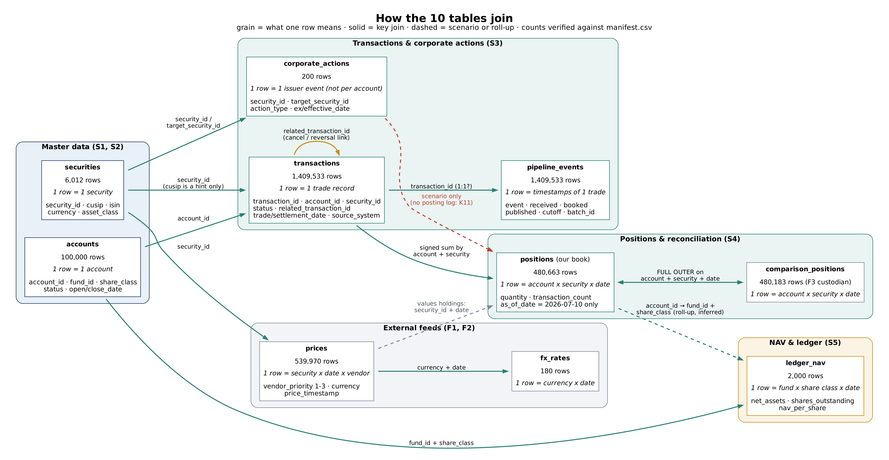
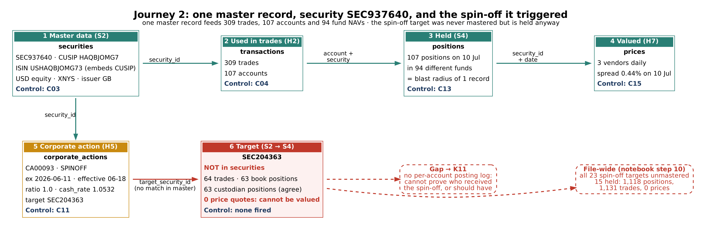

# Check-in 1 Team Report

*State Street case · BC Fall into BC Case Competition 2026 · prepared Sun 11 Oct 2026 for Check-in 1 on Mon 12 Oct*
*Companion files: `docs/Checkin1_Pack.pptx` (slides), `docs/Spine_Checkin1_v0.3.xlsx` (updated spine), `notebooks/checkin1_evidence.ipynb` (every number below), `docs/figures/` (diagrams). Source of truth is always `etc/01_Student_Brief.pdf`.*

---

## 0. In one minute

- **We are in good shape for Monday.** The spine already covers every Check-in 1 item the brief lists (control map and table, journey, detection-point model, KPIs with decisions, contracts, operating model). All 18 coverage checks in the workbook are green in v0.3.
- **I re-checked every number the spine quotes against the full data.** Most are exact. Three things changed, and they make our story *stronger*:
  1. The spin-off target `SEC204363` **is held**: 63 positions in our book, 63 at the custodian, 64 trades, but **no price**. The draft said nobody held it.
  2. Across the file, **15 securities that are not in the security master appear in 1,131 trades and 1,118 positions, and none has a price.** All 15 are spin-off targets. This is our best worked defect: it starts at corporate-action intake (D5), becomes an unmastered security (D1), and ends as holdings nobody can value (NAV risk).
  3. Settlement lag must be counted in **business days**. In calendar days, every Friday trade looks late.
- **New for the deck:** a short section on how State Street actually works (Section 1), so we speak the sponsor's language.
- **Before you present:** read Section 6 (likely faculty questions) and decide the open items in Section 3.3.

---

## 1. State Street: what they do and why this case is their business

All facts below are from public sources (listed at the end). We use them as context, **not** as claims about State Street's internal systems.

### 1.1 The company in three lines

- State Street is one of the world's largest **custodian and asset-servicing banks**. In Q2 2026 it reported a record **$57.9 trillion in assets under custody and/or administration (AUC/A)** and **$6.3 trillion in assets under management** (State Street Global Advisors).
- Its Investment Servicing business describes itself as offering *"a full range of back-, middle- and front-office solutions, including custody, accounting and fund administration"* (Q1 2026 10-Q).
- Since buying **Charles River Development** (front-office order and portfolio management software, 2018, about $2.6 billion), it sells **State Street Alpha**, a *front-to-back* platform: Charles River for the front office, State Street's middle- and back-office servicing behind it, and the **Alpha Data Platform** (launched December 2020, built with Snowflake and Microsoft Azure) as the shared data layer.

### 1.2 How that maps onto our case

| Case concept | What it means at a firm like State Street (public description) | Our spine IDs |
|---|---|---|
| Front office (PMs, traders) | Client's portfolio managers using an order management system such as Charles River | S1 account use, F4 `OMS_FRONT`, R6 |
| Middle office | Trade capture and matching, pricing, reconciliation, corporate actions: often **outsourced to the custodian** | S2, S3, S4, R2 to R8 |
| Back office | **Fund accounting**: the official books (ABOR) and the daily NAV | S5, R9 |
| Custodian | The bank that holds the assets and reports positions | F3 `comparison_positions` |
| "One data spine" | Alpha's pitch is one consistent data set from front to back, so IBOR (investment view) and ABOR (accounting view) agree | Our whole framework |

**Why this matters for our pitch:** in a front-to-back model, one provider owns several handoffs that used to sit in different firms. That makes it *possible* to move controls upstream (our detection-point model), and it makes the cost of a defect that crosses offices *their* problem. Our case is a small model of exactly that business.

### 1.3 Two market facts worth one sentence each in the deck

- **T+1 settlement.** The US moved to one-business-day settlement on **28 May 2024** (SEC Rule 15c6-1). The EU, UK and Switzerland plan to follow on **11 October 2027**. Less time between trade and settlement means less time to catch a bad record before it costs money. That is our "detect early" argument in market terms.
- **Operational risk is a disclosed risk.** State Street's own filing warns that *"errors or delays in our operational and transaction processing, or those of third parties, could have an adverse effect"*. We can quote this to show the problem is real, without claiming anything about their systems.

---

## 2. Check-in 1 checklist: what the brief asks for and where we have it

| Brief item (section 4 and 8) | Where it is | Status |
|---|---|---|
| Control map: 1 diagram, 5 stages x 3 offices, every handoff marked | `figures/01_control_map.png`, slide 2 | Ready |
| Control table: one row per control (checks, stage, failure response, owner) | Spine tab `C_Controls` (C01 to C20), slide 3 | Ready |
| Per stage: what must be true to leave clean, which control, which owner | Spine tab `SX_StageExit`, slide 3 | Ready |
| Journey: 1 trade + 1 master record, record IDs, observed vs inferred, gaps as missing contracts | `J_Journey`, `figures/04` and `05`, slides 5 and 6 | Ready, **corrected** |
| Detection-point model (the core of Part One) | `DP_Detection`, `figures/03_detection_matrix.png`, slide 4 | Ready |
| KPI table by office: formula, unit, owner, target, one sentence on the decision | `M_KPIs` (M01 to M20), slide 7 | Ready |
| At least 6 quality dimensions, and why obvious ones are excluded | `Q_Dimensions`: 8 in scope, **3 exclusions added in v0.3** | Ready |
| Data contracts as testable conditions | `K_Contracts` (K01 to K09 testable, K10 to K14 missing contracts), slide 8 | Ready |
| Operating model (1 page, 5 questions, one worked defect) + maturity path | `OM_OperatingModel`, slide 9 | Ready, **numbers updated** |

---

## 3. Review of the spine workbook

### 3.1 Verdict: you are doing it correctly

The spine is the right idea and it is well built. What is especially good:

- **One ID system for everything** (S, F, H, R, D, Q, C, K, M). Every control names its handoff, defect, contract and owner, so a gap is visible immediately.
- **The Coverage tab turns the merge checklist into formulas.** This is exactly the kind of "testable, not aspirational" thinking the brief rewards.
- **Owners are roles**, missing data becomes a **named missing contract** (K10 to K14), KPIs carry a **denominator and a missing-data rule**, and every KPI says which **decision** it supports. These are the four things the brief says most teams forget.
- The journey is **already grounded in real record IDs**, which the brief only requires for the final submission.

### 3.2 What I changed in v0.3 (every changed cell has a "v0.3:" note)

v0.3 replaces the earlier v0.2 draft. Every changed cell carries a "v0.3:" note, so the table below can be traced cell by cell.

| # | Tab | Change | Why |
|---|---|---|---|
| 1 | `J_Journey` hop 5 | Target `SEC204363` **is** held (63 book, 63 custodian positions, 64 trades, 0 prices) | Draft said no account holds it. Data says otherwise (notebook step 10). |
| 2 | `OM_OperatingModel` | Worked defect rewritten as a **D5 to D1 cascade** with verified numbers: 15 unmastered targets held in 1,118 positions and 1,131 trades, 0 prices; 1,896 accounts in 494 funds hold a spin-off source | 1,893 in the draft was close; the exact count is 1,896 |
| 3 | `Change_Requests` | Approved CR 1 (D4 now includes FX) and CR 2 (D5 covers incomplete events); added CR 3 and CR 4 | The only red cell in Coverage was "2 change requests pending" |
| 4 | `D_Defects` | D1 renamed to stress "securities held or traded but never mastered" | It is now our headline defect |
| 5 | `C_Controls` C06 | Settlement lag in **business days**, limit 2 unless note = `EXTENDED_SETTLEMENT_AGREED` | Calendar days make every Friday trade look late. See 3.4. |
| 6 | `C_Controls` C11 + `K_Contracts` K05 | Terms must be **type-conditional**, and `effective_date` must be **defined per action type** | All 200 events carry a `cash_rate` (even splits), and 87 of 200 have `ex_date` after `effective_date`. Whether that is wrong depends on the definition, so the contract must say it. |
| 7 | `M_KPIs` M04 | Office FO changed to **MO** | Its owner R5 (platform operations) sits in MO |
| 8 | `Q_Dimensions` | Added Q9 Precision, Q10 Accessibility, Q11 Lineage as **excluded with a reason** | Brief: "say why you excluded any obvious ones". Before, nothing was excluded, so that sentence had nothing to point at. |
| 9 | `DP_Detection`, `C16` notes | First evidence from the data added to D1, D4, D5, D10 | Gives each detection row one real number |

### 3.3 Open decisions for the team (5 minutes before Check-in)

1. **Spine statuses** are all still `draft`. Agree them as v1 so we can say "frozen spine" to faculty.
2. **REVERSED semantics (D8, K13):** state or offsetting event? Bring both readings; the brief wants us to compare them, not pick silently.
3. **NAV materiality threshold (C19):** use CSSF 24/856 (0.2% money market, 0.5% bond/mixed, 1% equity) as an *external reference*, clearly labelled as not State Street policy?
4. **Who presents what** (Section 5). Faculty may ask anyone about any part.

### 3.4 Smaller observations (no change made, worth knowing)

- **Settlement lag profile (business days):** T+1 913,711 · T+2 490,054 · T+5 to T+7 2,957, of which only 845 have the agreed-extension note · 1,124 settle *before* the trade date · 1,687 have an unparseable date. So we already have look-alikes (845 with a note) and confirmed-looking breaches (2,112 long lags without a note, 1,124 negative lags) for Check-in 2.
- **Date formats:** 9,398 trade dates use `DD/MM/YYYY`; settlement dates are all ISO. Good evidence for M09 (date-format conformity).
- **USD `rate_to_usd` is never exactly 1** (0.990 to 1.010 over all 30 days). Either a defect or a convention we have not understood. Keep it **unresolved** until Check-in 2, and say so.
- **Vendor timestamps:** for `SEC937640` on 10 Jul, VENDOR_C's quote is stamped 19:00, after the 18:00 pipeline cutoff. Worth a freshness rule in C14.
- **Zero-opening dip:** the journey trade's rebuilt holding goes to -2,422 on 9 Jun. That is the brief's zero-opening convention, not proof of a short. A good candidate for one of our two **cleared look-alikes**.

---

## 4. Verified numbers (all from `notebooks/checkin1_evidence.ipynb`, full data, runs in about 15 seconds)

| Claim | Spine said | Data shows | Status |
|---|---|---|---|
| All 10 tables match `manifest.csv` row counts | yes | yes | Confirmed |
| `TXN100000380` is unique; qty x price = gross | yes | 1 row; difference 0.0008 | Confirmed |
| Rebuild = book = custodian for the journey position | 2,028 | 2,028 / 2,028 / 2,028 | Confirmed |
| Lowest running total (zero opening) | -2,422 | -2,422 | Confirmed |
| `SEC937640`: trades / accounts | 309 / 107 | 309 / 107 | Confirmed |
| `SEC937640`: positions / funds on 10 Jul | 107 / 94 | 107 / 94 | Confirmed |
| Spin-offs with unmastered target | 23 of 23 | 23 of 23 | Confirmed |
| Mergers with no target | 31 of 31 | 31 of 31 | Confirmed |
| Holdings / funds in spin-off source securities | 1,893 / 494 | **1,896 / 494** | Corrected |
| `SEC204363` held by any account | not held | **63 book, 63 custodian, 64 trades, 0 prices** | **Corrected** |
| Unmastered securities anywhere in trades or positions | not stated | **15 securities, 1,131 trades, 1,118 positions, 0 prices** | New |
| Corporate actions with `ex_date` after `effective_date` | not stated | **87 of 200** | New |
| Corporate actions carrying a `cash_rate` | "unusual for a spin-off" | **200 of 200** | Corrected |
| USD `rate_to_usd` range | 0.990 to 1.010 | 0.990 to 1.010, never 1 | Confirmed |
| Journey NAV arithmetic | holds | 40,777,112.07 / 3,594,046.98 = 11.345737 | Confirmed |

**How to rerun:** open the notebook from the repo, choose a Python 3 kernel with `duckdb` and `pandas` (`pip install duckdb pandas`), and Run All. Each step has a plain-language explanation of what the SQL does.

---

## 5. Suggested 15-minute talk track

The slide pack follows the brief's order. Since roles are not split yet, here is a natural split for five people (everyone speaks, as the final presentation requires).

| Slide | Content | Time | Suggested speaker |
|---|---|---|---|
| 1 | Title + our thesis: catch it where it enters | 0:30 | A |
| 2 | Control map | 2:00 | A |
| 3 | Control table + stage exit criteria | 1:30 | A |
| 4 | Detection-point model (the core) | 2:30 | B |
| 5 | Journey 1: one trade | 1:30 | C |
| 6 | Journey 2: one security and the spin-off | 2:00 | C |
| 7 | KPIs by office | 1:30 | D |
| 8 | Data contracts + missing contracts | 1:30 | E |
| 9 | Operating model, worked defect, maturity path | 2:00 | E |
| 10 | What we want feedback on | 0:30 | A |
| A1 to A7 | Appendix: State Street context, full control table, full KPI table, table joins, verified numbers | as needed | anyone |

---

## 6. Questions faculty are likely to ask (with short answers)

1. **"Why does S3 span front and middle office?"** Trades are *created* in the front office (OMS) but *captured, validated and booked* in the middle office. The handoff inside S3 (H3) is where most of our capture controls sit.
2. **"How can a security be held if it was never mastered?"** Because nothing stopped it. 1,131 trades in 15 unmastered securities were booked. Control C04 (trade reference-data gate at H2) would have held every one of them. That is the detection-point argument in one sentence.
3. **"How do you tell a duplicate from two genuine identical trades?"** Unique `transaction_id` first, then an economic key (account, security, date, type, quantity, price), then `related_transaction_id` and `batch_id`. Without a source message ID we cannot *prove* a resend, so that is a missing contract, and such cases stay **unresolved**, not confirmed.
4. **"Isn't a negative running position an error?"** Not by itself. The brief's benchmark starts from zero, and negatives can be shorts. We will clear or confirm it with independent evidence (the custodian agrees at the end).
5. **"Why business days for settlement?"** A Friday trade settling Monday is T+1, not "3 days late". Counting calendar days would flag hundreds of thousands of valid trades (false positives).
6. **"Why do the defect owner and the control owner sometimes differ?"** The brief asks exactly this. The stage where a defect *enters* names its owner; the control that *should have caught it* may sit one handoff later. For the spin-off, R4 owns the event (entry), R2 must master the target, and R9 is told about every affected fund.
7. **"What is material for a NAV?"** We have no sponsor threshold. As an external reference only: Luxembourg CSSF Circular 24/856 uses 0.2% (money market), 0.5% (bond and mixed) and 1% (equity).
8. **"How do you stop a KPI from being gamed?"** Every score shows its coverage; missing or unevaluable records are reported separately and can never raise a score; thresholds live in a versioned rule file, not edited by hand.
9. **"Why not use AI to detect defects?"** Rules detect, AI explains. Judges will rerun our code and change thresholds live, which needs deterministic rules. AI can summarise and suggest hypotheses on top.

---

## 7. Housekeeping

1. **Rename "Jane Street" to "State Street".** I could not rename the parent folder from this session, because it sits above the folder you connected and renaming it would break the link. After this session:
   - Finder: rename `Jane_Street_Case_Competition` to `State_Street_Case_Competition`.
   - GitHub: repo Settings, Repository name: `BC-State-Street-Case-Competition`. Then in Terminal, inside the repo folder:
     `git remote set-url origin https://github.com/KevinRusu/BC-State-Street-Case-Competition.git`
     (GitHub also redirects the old URL, so nothing breaks in the meantime.)
2. **The data is committed to git.** `data/*.csv.gz` is in your first commit and on GitHub. That is fine **only if the repo is private** (the brief forbids public repos). Please double-check it is private, add teammates as collaborators only, and add a `.gitignore` with `data/`, `.DS_Store` and `.claude/` before the next commit.
3. **AI log.** The brief requires the prompts and responses that shaped the work. Export this conversation and keep it in an `ai_log/` folder.
4. **Confidentiality.** Nothing here was published online. The slides and report are local files only.

---

## 8. Tools: Cowork or Claude Code in VS Code?

**Use both, by phase.**

| Phase | Best tool | Why |
|---|---|---|
| Part One (now): research, spine, diagrams, slides, report | **Claude Cowork** (this app) | Works across your folder, the web and Office files; good at documents and decks; you review outputs, not code |
| Part Two (Check-in 2 onward): `src/`, `run_all.py`, rule catalog, tests, Streamlit dashboard | **Claude Code in VS Code** | Lives inside the repo, edits many files at once, runs tests and git, and you see every diff, which helps you learn the code |
| Final deck and report | **Cowork** again | Pulls numbers from the code outputs into slides |

**Plugins.** You already have the most useful ones enabled:

- **Data** (`explore-data`, `validate-data`, `sql-queries`, `statistical-analysis`, `build-dashboard`): profiling tables, checking an analysis before you present it, and the executive dashboard.
- **Finance** (`reconciliation`, `sox-testing`, `audit-support`): reconciliation break categories and control-testing language, which matches our position recon and control table.
- **Engineering** (`testing-strategy`, `documentation`, `architecture`): the stress test, row-shuffle test and README for the code package.
- Worth adding: Anthropic's **Operations** plugin (`process-doc`, `runbook`, `risk-assessment`) for the operating model.
- **Avoid** third-party plugins that send content to outside servers (for example generic "make me slides" services). The brief only allows approved tools for the data.

---

## 9. Next steps toward Check-in 2 (week of 19 Oct)

1. Freeze spine v1 and export the spine tabs to `config/spine/*.csv` so code uses the same IDs.
2. Turn the notebook queries into `src/ingest.py` with a row ledger (rows in and out of every step).
3. Full transaction rebuild: BOOKED-only baseline, then trade-date vs settlement-date, then the two REVERSED readings side by side.
4. Full outer reconciliation: rebuild vs `positions`, and `positions` vs `comparison_positions`.
5. First defect catalog using the 7-field template (Working Guide section 6), starting with D1/D5 (unmastered spin-off targets), D10 (settlement dates) and D4 (USD rate).

---

## Appendix: the diagrams

All five are in `docs/figures/` as PNG files. The scripts that draw them are in `docs/figures/src/` (matplotlib and Graphviz), so you can edit a label and redraw.

---

## Sources

- State Street, [Q2 2026 earnings press release (Form 8-K)](https://www.sec.gov/Archives/edgar/data/0000093751/000009375126000387/a2q26earningspressrelease.htm): AUC/A $57.9tn, AUM $6.3tn.
- State Street, [Form 10-Q for Q1 2026](https://www.sec.gov/Archives/edgar/data/0000093751/000009375126000196/stt-20260331.htm): Investment Servicing description, CRD as the foundation of Alpha, operational risk language.
- Business Wire, [State Street Expands State Street Alpha with New Front to Back ETF Capabilities (June 2023)](https://www.businesswire.com/news/home/20230613568016/en/State-Street-Expands-State-Street-Alpha℠-with-New-Front-to-Back-ETF-Capabilities).
- The TRADE, [State Street launches cloud-native Alpha data platform (Dec 2020)](https://www.thetradenews.com/state-street-launches-cloud-native-alpha-data-platform/).
- FinanzaOnline, [State Street acquista Charles River Development per $2,6 miliardi](https://www.finanzaonline.com/?p=534600).
- Davis Polk, [SEC adopts T+1 settlement effective May 2024](https://www.davispolk.com/insights/client-update/sec-adopts-t-1-settlement-effective-may-2024).
- The TRADE, [ESMA names 11 October 2027 for co-ordinated T+1 switch with UK](https://www.thetradenews.com/esma-names-t1-lead-as-11-october-2027-earmarked-for-co-ordinated-switch-with-uk/).
- Case documents: `etc/01_Student_Brief.pdf`, `etc/02_Dataset_Guide.pdf`, `docs/OVERVIEW.md` (CSSF 24/856 and 1-10-100 references are cited there).
