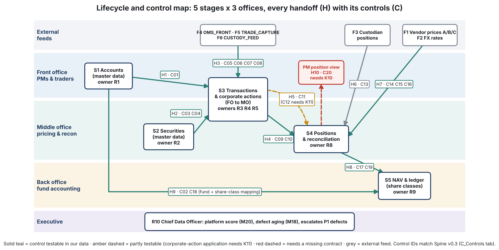

# The three offices: what each one does, and what can go wrong

*For teammates, to answer the jury's questions about the front, middle and back office. About ten minutes. The
answers are our Check-in 1 framework (`scripts/framework.json`, report in
[CHECKIN1_REPORT.md](../checkin1/CHECKIN1_REPORT.md) §3), put in plain words, with what the data has shown since.
Read [TEAM_GUIDE.md](TEAM_GUIDE.md) first.*

*Every number here comes from the run whose register checksum is `b29e95bb9740`. If the checksum at the top of
[FINDINGS.md](../../FINDINGS.md) is different, the notebook has been rerun and some numbers below may be out of date.
Small markers like [^reg] say which file each number comes from; the list is at the bottom.*

## The picture

Data flows **front → middle → back**. Each arrow is a handoff, and every handoff can drop, copy, delay or change the
data. Two things feed the line from the side, and they are easy to forget:

- **The two address books:** the list of accounts (who can trade) and the list of securities (what can be traded).
  They are not a step in the line; every office looks them up. A mistake in one of them spreads to everything that
  uses it.
- **Three independent sources:** the **custodian** (the bank that holds the securities and keeps its own record of
  every holding), the **price vendors** (three of them) and the **FX provider** (currency rates). They sit outside the
  platform's own flow, but their data must be checked like anyone else's.

*Why the custodian counts as a separate source, when State Street is itself a custody bank:* the case treats the
custodian's record as "the other side of your reconciliation"
([brief §6](../../../reference/01_Student_Brief.md#6-the-dataset)), and the accounts are spread over three different
custodians.[^custlabels] In real life the custodian may be another company or another part of the same one. Either
way its record must be made separately, or comparing the two lists proves nothing (insight 2 below).

## Part 1: what each office does

### The four questions, office by office

| | **Front office** | **Middle office** | **Back office** |
|---|---|---|---|
| **Who works there** | Portfolio managers and traders | Trade operations, pricing and reconciliation analysts | Fund accountants |
| **1. What it receives** | The account list (who can trade) and the security list (what can be traded) | The trades from the front office's systems, notices of company events (splits, mergers, spin-offs), the custodian's holdings, the vendors' prices and the FX rates | Every holding, checked and priced, grouped by fund and share class |
| **2. What it is responsible for, and what happens there** | Setting up accounts; deciding what to buy and sell; creating the trade | Booking each trade before the daily deadline; keeping the security list; applying company events to every holder; keeping the **official holdings list**; comparing it with the custodian; pricing every holding | Keeping the official books; working out each fund's price per share (the **NAV**) for every share class |
| **3. What it passes on** | Trade records: account, security, BUY or SELL, quantity, price, amount paid, trade and settlement dates | Holdings that equal their trades, agree with the custodian and carry a fresh price, plus the list of problems still open | The NAV that investors buy and sell at; reports for the executive |
| **4. The owners** | **Account onboarding lead** | **Security master lead**, **Trade operations lead**, **Corporate actions lead**, **Reconciliation lead**, **Pricing lead** | **Fund accounting lead** |

### What each owner is responsible for

Owners are **roles, not people**. The data shows which system touched a record, never who is accountable for it, so
choosing the owners was our design decision
([brief §4](../../../reference/01_Student_Brief.md#4-part-one--the-architecture)).

| Owner | Office | Responsible for | If their check fails |
|---|---|---|---|
| Account onboarding lead | Front | Every account is complete (fund, share class, currency, dates) and open before it trades | Hold the trade |
| Security master lead | Middle | Every security exists once, with valid codes and currency, before anyone trades it | Hold the trade |
| Trade operations lead | Middle | Every trade is unique, complete, readable, settles on time and is booked before the deadline | Reject it, or hold it for review |
| Corporate actions lead | Middle | Every company event has complete terms, and any new security is set up, before the event date | Put the event on hold |
| Reconciliation lead | Middle | Every holding equals its trades and agrees with the custodian; every difference is explained | Flag it and work it |
| Pricing lead | Middle | Every holding has today's price, the vendors agree, and every currency has one valid rate | Use the next vendor, or flag it |
| Fund accounting lead | Back | Net assets ÷ shares = NAV, and no serious open problem feeds the fund | Hold the NAV |

The detailed rules under each check are in [RULES.md](../../RULES.md).

## Part 2: what can go wrong, and what the next office needs

### 1. What could go wrong at each step (and what we actually found)

**Front office.** The trade is created with a mistake in it.

- BUY trades with a negative quantity: 655.[^reg] A quantity is never negative. This is the trade we traced
  ([STORY.md](STORY.md)).
- Trades with a blank quantity: 2,819.[^reg]
- Trade dates written two different ways (`DD/MM/YYYY` instead of `YYYY-MM-DD`): 9,398 trades.[^reg]
- Settlement date before the trade date: 1,124 trades.[^reg]
- Holdings on an account that was never set up: 699.[^reg]

**Middle office.** Trades are copied, events are half set up, sources disagree.

- Trades that arrived twice: 2,060.[^dup] (The register counts the rows: 4,064 exact copies.[^reg])
- Spin-offs whose new security was never set up: 23 events.[^reg] Those securities were still traded (1,131 trades)
  and held (1,118 holdings), but have no price at all, so the holdings can't be valued.[^cc]
- Holdings the custodian has no record of: 480.[^reg]
- Securities where the vendors disagree on the price by more than 0.5%: 388.[^reg]
- Prices in a currency with no FX rate: 1,080 price rows.[^reg]

**Back office.** The numbers don't add up.

- Fund rows where net assets ÷ shares ≠ NAV per share: 40 of 2,000.[^reg]

### 2. What the next office needs to be true (our "data contracts")

A data contract is a promise one office can demand from the one before it, written so a computer can test it.
"Data should be accurate" is a wish; "every security on a trade exists once in the security list" is a promise, and a
broken promise is something you can count.

| From → to | The promise | Checked by |
|---|---|---|
| Account list → trades | Every trade's account exists, is open on the trade date, and has a fund and share class | Account check |
| Security list → trades | Every security on a trade or company event exists once in the security list, with the same code and currency | Security check |
| Front → middle (trades → holdings) | Every trade is unique and complete, has readable dates, settles within 2 business days (unless an extension is agreed) and is booked before the deadline | Trade check |
| Company events → holdings | Every event has complete terms for its type, and any new security is set up at least 2 business days before the event date | Corporate action check |
| Independent sources → middle | The custodian sends one record per holding per day; every held security has today's price; one FX rate per currency per day, with the US dollar at 1 | Position check, price check |
| Middle → back (holdings → NAV) | Each fund and share class has one NAV row per day that adds up, and no serious open problem feeds it | NAV check |

*Where the mistake enters is often not where it's checked.* The negative BUY entered when the front office created the
trade, but the check that would stop it belongs to the trade operations lead in the middle office, because that is
where trades are accepted. The fix sits at the door of the next office.

### 3. The standard quality checklist

The Working Guide's checklist of quality dimensions ([Working Guide](../../../reference/03_Student_Working_Guide.md)
§3), applied to each office:

| Dimension | The question, plainly | Where it bites | Our example |
|---|---|---|---|
| Completeness | Is anything blank that shouldn't be? | Front | Blank quantities |
| Validity | Is the value possible? | Front | Negative quantity on a BUY |
| Conformity | Is it written the same way everywhere? | Front | Two date formats |
| Referential integrity | Does what it points at exist? | Front, middle | Holdings on unknown accounts; spin-off securities never set up |
| Uniqueness | Is it there only once? | Middle | Duplicate trade copies |
| Timeliness | Did it arrive in time? | Front, middle | Booked before the deadline; today's price (to measure for the final) |
| Consistency | Do two records that should agree, agree? | Middle, back | Official list vs custodian; NAV arithmetic |
| Accuracy | Does it match an independent reference? | Middle | The three vendors' prices |

## The result: controls, and insights for future platform work

**Controls.** Seven checks, one at each handoff, each with an owner and a response when it fails (the owner table
above). Six of them are **preventive**: they stop bad data before it moves on. The position check is **detective**:
it finds differences afterwards, because the custodian's record only arrives later.

**Insights.**

1. **Catch it where it enters.** The negative BUY passed every check after it got in, because each later check
   compared it with something that carried the same mistake ([STORY.md](STORY.md)).
2. **Two sources agreeing is not proof.** The custodian follows the official list's own habits, counting duplicate
   copies or subtracting every "undo" record, on 2,704 holdings.[^cust] So a match between them can hide a shared
   mistake.
3. **Mistakes in the address books spread widest.** A spin-off security that was never set up leaves every holder
   with a holding nobody can price.[^cc]
4. **Say what can't be proved.** We name the data that is missing instead of guessing: a log of which accounts
   received each company event, the custodian's confirmation that a trade settled, cash and fees per fund, and a
   clear "type of change" on each trade ([CHECKIN1_REPORT.md](../checkin1/CHECKIN1_REPORT.md) §3.6).

---

[^reg]: `outputs/02_defect_register.csv`, lines "Negative trade quantity" (655), "Blank trade quantity" (2,819),
    "trade_date written as DD/MM/YYYY" (9,398), "settlement_date before trade_date" (1,124), "Position on an
    account_id missing from accounts" (699), "Repeated transaction_id: exact full-row copy" (4,064), "Corporate-action
    target security missing from securities" (23), "Position in the book with no custodian record" (480), "Vendor
    quotes on the snapshot date: spread above threshold" (388), "Price with no FX rate for its currency on the price
    date" (1,080), "NAV arithmetic does not hold" (40 of 2,000).
[^dup]: `outputs/02_duplicate_profile.csv`, row "repeated transaction_ids that are copies (exact or date format
    only)" (2,060 distinct transaction_ids).
[^custlabels]: `data/accounts.csv.gz`, column `custodian`: three labels, CUST_HARBOR, CUST_MERIDIAN and CUST_NORTH.
[^cc]: `outputs/01_cross_check.csv`, rows "missing spin-off targets: transaction rows" (1,131), "…: position rows"
    (1,118) and "…: price rows" (0).
[^cust]: `outputs/02_trace.csv`, hop `custodian`, note on "positions with a negative-quantity trade: custodian equals
    the book" (the book's duplicate or REVERSED convention on 2,704 positions).
