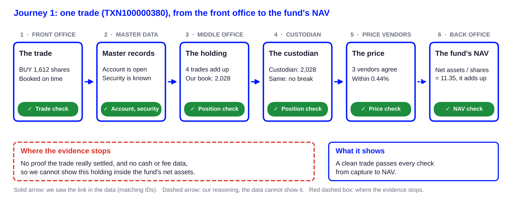
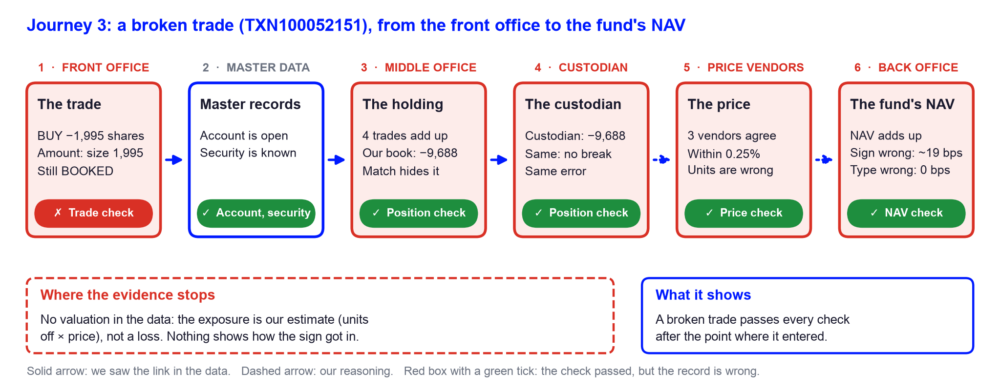

# The story: one broken trade, from the trading desk to the fund

*For teammates, before the Check-in 2 dry run. About ten minutes. Frozen after Check-in 2; the final gets its own
story in `docs/final/`.*

*Every number here comes from the run whose register checksum is `d43040c69f8c`.[^findings] If the checksum at the
top of [FINDINGS.md](../../FINDINGS.md) is different, the notebook has been rerun and some numbers below may be out of
date. Small markers like [^t-src] say which file each number comes from; the list is at the bottom.*

## The story in three sentences

At Check-in 1 we followed a clean trade through the platform, and it passed every check. This time we follow a
broken trade, and it **also** passes every check after the point where it came in, because each later check compares
it with something that carries the same mistake. The only place it can be stopped is where it enters: at trade capture.

| Check-in 1: a clean trade | Check-in 2: a broken trade |
|---|---|
|  |  |

**How to read each step.** Every step has the same four parts:

- **What happens here:** what this step does on any platform.
- **What we saw** *(observed)*: read straight from the data. You can look it up.
- **What we conclude** *(inferred)*: our reasoning. The data does not show it directly.
- **What a check here sees:** whether a control at this step would notice anything.

Terms in **bold** are explained in [Words used here](#words-used-here) at the end.

Along the way we stop three times for a **detour**: another kind of problem that enters at that same step. The
detours give one count and one example each. The full write-ups are in [DEFECT_CATALOG.md](../../DEFECT_CATALOG.md).

---

## Step 1: The trade (front office)

**What happens here.** Someone decides to buy or sell. The trading system records the trade and sends it into the
platform.

**What we saw** *(observed)*. Trade `TXN100052151` is a BUY of security `SEC961485` for account `ACC1014776`, sent by
the system `OMS_FRONT` on 2026-06-02.[^t-src] Its quantity is **−1,995**.[^t-src] A BUY adds shares, so its quantity
should be positive: the Dataset Guide says quantity is a size, never negative
([§3](../../../reference/02_Dataset_Guide.md#the-shared-reconstruction-benchmark)).

The same row also has a price of 88.5356 and a gross amount (the money paid) of 176,628.52.[^t-src] Money divided by
price gives **1,995** shares.[^t-src] So the money confirms the **size** of the trade. It can't confirm the
direction: the gross amount is positive on every BUY and on every SELL in the file, so it never carries a
sign.[^sign]

What we know for sure is that the record is wrong, because a quantity is never negative. What we don't know is
*which* field is wrong: the sign (it should be a BUY of +1,995) or the type (it should be a SELL of 1,995). Step 3
shows what each reading means for the holding. Even so, the status is BOOKED: the platform accepted it as a normal
trade.[^t-src]

The **pipeline** handled it normally. It was received at 10:09, booked at 10:15 and published at 10:22, all before
the 18:00 **cutoff**, and there is exactly one pipeline record for it.[^t-pipe]

**What we conclude** *(inferred)*. The minus sign was already in the row when `OMS_FRONT` sent it, and nothing
later changes the quantity.[^t-src] We can't see *why* the source sent it that way.

It also doesn't look like one broken feed:

- `OMS_FRONT` sends 50% of all negative quantities and 49.99% of all trades. The other two systems also match their
  normal share.[^t-pipe]
- This trade's batch held only 5 negative quantities among 6,635 records.[^t-pipe]

So our best reading is scattered bad entries, not one faulty system.

**What a check here sees.** Nothing today: the trade was booked. The check we propose would reject it right here
(see [The fix](#the-fix)).

> **Detour: duplicate trade copies (pipeline).** The same trade can arrive twice. 4,064 trade rows are exact copies
> of another row: same ID, every field equal (example `TXN100002453`).[^r-dup] We remove the copies before adding up
> trades. The book and the custodian seem not to: on 2,021 positions, both hold exactly the number you get if the
> copies are counted as real trades (example `ACC1000158` / `SEC181706`).[^r-dupkeys] **Unresolved:** this could be
> a defect or the book's own convention, and it is on our list of questions for faculty. Not yet traced hop by hop.

## Step 2: Master records

**What happens here.** Every trade points at an account and a security. Both must already exist in the
**master data**, the platform's address book of accounts and securities.

**What we saw** *(observed)*. The account is OPEN and belongs to fund `FND00317`, share class R. The security is in
the master file as an EQUITY.[^t-down]

**What we conclude.** Nothing is wrong here for this trade. This step is clean.

**What a check here sees.** A pass, and a correct one.

> **Detour: spin-off targets never set up (master data).** In a **spin-off**, a company splits off part of itself
> and holders receive shares of a new security. That new security must exist in the master file first. In 23
> spin-off events it doesn't (example `CA00005`, whose new security `SEC304911` is missing).[^r-ca][^ca] So we
> quarantine these events: we don't apply them, and we don't guess.
>
> Separately, 1,118 position rows sit on a security that isn't in the master file, and 1,118 position rows hold a
> security with no price at all.[^r-sec] The three example securities in that register line are each the new
> security of a spin-off: `SEC188562` (`CA00015`), `SEC204363` (`CA00093`) and `SEC219998` (`CA00105`)
> *(observed)*.[^ca] Notebook 01 checked this for all of them, not just the examples: the 1,118 position rows sit on
> 15 securities, every one a spin-off target that was never set up, with 1,131 trades and 0 prices
> *(observed)*.[^cc] **Confirmed.** Not yet traced hop by hop.

## Step 3: The holding (middle office)

**What happens here.** The middle office keeps the **book of record**, the platform's official list of what each
account holds. We test it with a **rebuild**: start from zero and add up every trade for that account and security
(BUYs add, SELLs subtract). If the rebuild equals the book, the position "matches".

**What we saw** *(observed)*. This account has four trades in this security: the BUY of −1,995 and three SELLs of
1,730, 1,050 and 4,913.[^t-pos] The rebuild gives −9,688, and the book says −9,688.[^t-pos] They match.

**What we conclude** *(inferred)*. The book added up the same wrong row we did, so of course they agree. Whether the
match **hides** an error in the holding depends on which field of the trade is wrong (Step 1):

- **Wrong sign** (it should be a BUY of +1,995): the holding would be −5,698. That differs from the book by
  2 × 1,995 = 3,990 shares.[^t-pos][^t-down]
- **Wrong type** (it should be a SELL of 1,995): a SELL of 1,995 moves the holding the same way as a BUY of −1,995,
  so the holding is −9,688 and the book is right.[^t-pos]

**Wrong sign is the better-supported reading.** Of the 655 negative BUYs, 5 have a second record of the same trade:
a copy with the same ID, a rebook, a reversal, or the original that a reversal points at. On all 5, that second
record is a BUY with a positive quantity *(observed)*.[^r-neg][^partners] Five cases is a lean, not a proof. This
trade has no second record, so its own data can't decide.[^t-src] Deciding needs the order side from the source
system or the direction of the cash movement, which is a question for faculty.

*Why is the holding negative either way?* The three SELLs are bigger than the one BUY. A negative holding is not
wrong in itself. The rebuild starts from zero at the beginning of the data (a convention of the exercise), and a
negative holding can be a short position
([Dataset Guide §3](../../../reference/02_Dataset_Guide.md#the-shared-reconstruction-benchmark)). The defect is the
sign of this one trade, not the negative total.

**What a check here sees.** "Match." Under the wrong-sign reading it passes, but it shouldn't. Under the wrong-type
reading the holding is right, and only the trade record is wrong.

## Step 4: The custodian

**What happens here.** The **custodian** is the outside bank that actually holds the securities. Its report is our
second opinion: when the book and the custodian agree, we normally trust the number.

**What we saw** *(observed)*. The custodian says −9,688, the same as the book.[^t-cust]

**What we conclude.** This is the turning point of the story. If the sign is wrong, the custodian repeats the book's
mistake, so comparing the book with the custodian cannot catch it.[^t-cust] **Two sources agreeing is not proof that
either one is right.**

Across the 645 positions with a negative BUY that all three sources hold, the custodian equals the book on 641 and
never holds the wrong-sign value *(observed)*.[^t-cust] That looks like support for the wrong-type reading, but it
isn't. The custodian also follows the book's own conventions: it counts duplicate copies or subtracts every REVERSED
row on 2,704 positions.[^t-cust] So it is not an independent source. In the first detour, for example, book and
custodian agree on a duplicate-inflated number on 2,021 positions.[^r-dupkeys]

**What a check here sees.** "No break." It passes; if the sign is wrong, it shouldn't.

> **Detour: custodian missing holdings (reconciliation).** Sometimes the custodian has no record at all. 480
> positions are in the book with no custodian record (example `ACC1012432` / `SEC471303`).[^r-nocust] For 478 of
> them our rebuild also has trades, and on 475 the rebuild agrees with the book.[^3way] So the trades back the book,
> and our reading *(inferred)* is a gap in the custodian's feed. **Unresolved:** we need the custodian's side to
> confirm it. Not yet traced hop by hop.

## Step 5: The price

**What happens here.** To value a holding, multiply its units by a price. Three outside price vendors quote each
security, and the platform uses the highest-priority vendor's price.

**What we saw** *(observed)*. On the snapshot date, 3 vendors quoted this security.[^vendor] The gap between their
highest and lowest price was about 0.25% of the average, inside our 0.5% limit, so the price check passes.[^vendor][^config]

**What we conclude** *(inferred)*. The holding would be valued at 89.1807 USD, the price from VENDOR_A, the
priority-1 vendor.[^t-down] The price is fine. The units it multiplies are wrong, and a price check can't see that.

**What a check here sees.** A pass. Correct for the price, blind to the quantity.

## Step 6: The fund's NAV (back office)

**What happens here.** The back office works out the fund's **NAV** (net asset value): what the fund is worth, and
per share, the price investors buy and sell at. One basic check: net assets ÷ shares outstanding = NAV per share.

**What we saw** *(observed)*. The account belongs to fund `FND00317`. Its share classes' net assets add up to
183,372,640.45 USD.[^t-down] The NAV arithmetic holds on all four of its rows.[^nav]

**What we conclude** *(inferred)*. Under the wrong-sign reading, the book is off by 3,990 shares.[^t-down] At
89.1807 USD each, that is an indicative **exposure** of 355,830.99 USD, about 19 **basis points** of the fund's net
assets.[^t-down] Under the wrong-type reading, the holding is right and the exposure is zero.[^t-down] So the
exposure is either about 19 bps or nothing, and the better-supported reading gives the 19 bps.

This is exposure, not a loss: it measures how much of the fund's reported value rests on a wrong number. It assumes
the price is per share and the ledger is in USD (as the data dictionary says). The data has no valuation of each
holding, so we can't show this amount inside the fund's net assets. That is where the evidence stops.

**What a check here sees.** The NAV arithmetic adds up. It checks that three numbers agree with each other; it
can't know that a holding underneath them is wrong.

---

## The fix

The check that stops this trade is `TXN_FIELDS_VALID` at trade capture: the quantity must be above zero, and the
gross amount must equal quantity × price within 0.01.[^t-ctrl] **Owner:** the Trade operations lead.
**On failure:** reject the trade.[^t-ctrl]

Across the whole file, this rule flags 655 trade rows with a negative quantity, all of them BUYs.[^r-neg] That's out
of 1,406,714 rows it could test; another 2,819 have a blank quantity and can't be tested.[^r-neg] Each one is
**confirmed** as a defective record, because a quantity is never negative
([Dataset Guide §3](../../../reference/02_Dataset_Guide.md#the-shared-reconstruction-benchmark)): the record is wrong
whichever reading is right. On 654 of the 655, the money fits the size of the trade, but not its side.[^r-neg]

What stays **unresolved** is the correct value of each row. So the correction waits until something shows the side:
a second record of the same trade (5 rows have one[^r-neg]) or the source's order side. Taking the absolute value is
never the fix. The rule that looks for second records is `TXN_NEGATIVE_SIDE_EVIDENCE` in
[RULES.md](../../RULES.md) §3.

The lesson, and the brief's own words: "the cost of a defect rises with the distance between where it enters and
where it is found" ([brief §1](../../../reference/01_Student_Brief.md#1-why-this-matters)). Once this trade got past
capture, every later check compared it with a copy of itself.

## The ending: something that looked wrong but wasn't

Not every flag is a defect. Clearing a flag properly counts as much as confirming one
([Working Guide §5](../../../reference/03_Student_Working_Guide.md)).

**What we flagged.** 42 positions where the trades add up to exactly zero (everything bought was sold again), and
neither the book nor the custodian reports the position.[^r-clear] At first sight these are missing positions.

**The rule, written before we looked.** A position whose trades net to zero, and that neither source reports, is a
closed position that simply isn't listed ([D-024](../../DECISIONS.md)).

**Independent evidence** *(observed, from a different table than the flag)*. Does either source ever list a
position with quantity zero? The book has 0 such rows, and the custodian has 0.[^r-clear] So neither one lists
closed positions anywhere, and their silence about these 42 is normal behaviour. (Our first argument, "the custodian
is also silent", was true by construction and proved nothing. That's why D-024 replaced it.)

**Population.** 42 positions cleared, out of 478,026 that could be evaluated; 2,836 could not be evaluated
(example `ACC1269575` / `SEC116404`).[^r-clear]

**What would change our mind.** A zero-quantity row in either source, or a later non-zero record for one of these
positions.[^r-clear]

**Status: cleared.**

## What we haven't proved yet

- Only one trade has been traced hop by hop. The three detours are counts and examples. The final needs at least
  three full traces and two cleared flags ([brief §5](../../../reference/01_Student_Brief.md#5-part-two--the-demonstration)).
- Some differences have no explanation yet, and we keep them visible instead of forcing them into a class. On 1,886
  positions the custodian disagrees with both the book and the trades. On 717, book and custodian agree on a number
  the trades don't explain.[^classes]
- Which field is wrong on each negative BUY. Wrong sign is better supported, but only 5 rows have a second record to
  show it.[^partners] The rest need the order side or the cash direction from the source.
- The exposure is an estimate. The data has no valuation, cash or fees.

## Where you'll see this on Monday

Slide numbers from the deck outline in [CHECKIN2_PLAN.md §5](CHECKIN2_PLAN.md#5-deck-outline-8-to-10-slides-answer-first).

| Part of this story | Slide |
|---|---|
| Steps 1 to 6 and the fix | The trace |
| Step 4 and the custodian detour | Three-way reconciliation |
| The detours and the ending | Defect catalog |
| What we haven't proved yet | Questions for faculty |

## Words used here

| Word | Meaning |
|---|---|
| **Basis point (bps)** | One hundredth of one percent. 100 bps = 1%. |
| **Book of record** | The platform's own official list of what each account holds (`positions`). |
| **Break** | A difference between two sources that should agree. A break must be explained; it is not automatically an error. |
| **Confirmed / unresolved / cleared** | Confirmed: we have independent evidence it is wrong. Unresolved: we can't yet say. Cleared: it looked wrong, and a stated rule plus independent evidence shows it is fine. |
| **Custodian** | The outside bank that holds the securities. Its report (`comparison_positions`) is our second opinion. |
| **Cutoff** | The daily deadline by which a trade must be booked. |
| **Exposure** | How much reported value rests on a wrong or unproven number. An estimate, never a realised loss. |
| **Master data** | The address book of accounts and securities that every trade points at. |
| **NAV (net asset value)** | What a fund is worth. Per share, it is the price investors buy and sell at. |
| **Observed / inferred** | Observed: read straight from the data. Inferred: our reasoning from it. |
| **Pipeline** | The route a trade takes from the trading system into the book (received, booked, published). |
| **Position** | What one account holds of one security on one date. In the code this is a "key". |
| **Rebuild** | Start from zero and add up every trade for an account and security. Our independent check on the book. |
| **Spin-off** | A company splits off part of itself; holders receive shares of a new security. |
| **Wrong sign / wrong type** | The two readings of a negative BUY. Wrong sign: it should be a BUY with a positive quantity, so the book is off by twice the trade. Wrong type: it should be a SELL, so the book is right. |

---

[^findings]: `docs/FINDINGS.md`, header line "Register checksum" (generated from `outputs/02_defect_register.csv`).
[^t-src]: `outputs/02_trace.csv`, hop `source` (fields `transaction_id`, `account_id`, `security_id`, `trade_date`,
    `quantity`, `price`, `gross_amount`, `status`, `source_system`; `gross_amount / price` = 1994.999977; "other
    records of this trade" = 0; "where it entered").
[^t-pipe]: `outputs/02_trace.csv`, hop `pipeline` (timestamps, "pipeline records for this transaction_id", "share of
    negative quantities by source_system": OMS_FRONT 0.5, TRADE_CAPTURE 0.2914, CUSTODY_FEED 0.2086 against all rows
    0.4999, 0.3001, 0.2; "negative-quantity records in the same batch").
[^t-pos]: `outputs/02_trace.csv`, hop `position` (book quantity, rebuilt quantity and its four contributing rows,
    "quantity under the wrong-sign reading", "quantity under the wrong-type reading").
[^t-cust]: `outputs/02_trace.csv`, hop `custodian` (quantity, "custodian equals the book"; "positions with a
    negative-quantity trade: custodian equals the book" = 641 of 645, its note: wrong-sign value on 0, the book's
    duplicate or REVERSED convention on 2,704 positions).
[^t-down]: `outputs/02_trace.csv`, hop `downstream` (account, fund, share class, asset class, fund net assets,
    "units misstated in the book", price used, indicative exposure in USD and in bps = 19.4048; each note: "under the
    wrong-sign reading", 0 under the wrong-type reading).
[^sign]: `outputs/02_sign_by_type.csv` (`gross_amount` is `positive` on all BUY and all SELL rows; a negative
    `quantity` occurs on BUY rows only).
[^partners]: `outputs/02_negative_partners.csv` (5 negative-quantity transaction_ids with a partner record; every
    row has `reading_supported` = wrong sign).
[^t-ctrl]: `outputs/02_trace.csv`, hop `control` (`TXN_FIELDS_VALID`, owner, on fail).
[^vendor]: `outputs/02_vendor_check.csv`, row for `SEC961485` (quotes, vendors, spread = 0.0024943, result).
[^config]: `config/reconciliation.toml`, `spread_threshold` = 0.005.
[^nav]: `outputs/02_nav_check.csv`, the four rows for `FND00317` (result `pass`).
[^r-dup]: `outputs/02_defect_register.csv`, line "Repeated transaction_id: exact full-row copy".
[^r-dupkeys]: `outputs/02_defect_register.csv`, line "Book and custodian count duplicate copies as trades"; same
    count in `outputs/02_break_classes.csv`, class "rebuild is the odd one out: counts duplicate copies".
[^r-ca]: `outputs/02_defect_register.csv`, line "Corporate-action target security missing from securities".
[^ca]: `outputs/02_ca_readiness.csv`: rows with verdict `quarantined` and reason `TARGET_NOT_MASTERED` (all
    `SPINOFF`); `target_security_id` of `CA00005`, `CA00015`, `CA00093`, `CA00105`.
[^cc]: `outputs/01_cross_check.csv`, rows "missing spin-off targets traded and held", "missing spin-off targets:
    transaction rows", "…: position rows" and "…: price rows" (also `outputs/01_defect_log.csv`).
[^r-sec]: `outputs/02_defect_register.csv`, lines "Position on a security_id missing from securities" and "Held
    security with no price at all".
[^r-nocust]: `outputs/02_defect_register.csv`, line "Position in the book with no custodian record".
[^3way]: `outputs/02_three_way_summary.csv`, row "rebuild + book, no custodian" (keys, "of which the two present
    agree").
[^r-neg]: `outputs/02_defect_register.csv`, line "Negative trade quantity" (affected, eligible, not evaluable,
    "how detected").
[^r-clear]: `outputs/02_defect_register.csv`, line "Closed position not reported" (affected, eligible, not
    evaluable, examples, "how detected").
[^classes]: `outputs/02_break_classes.csv`, classes "custodian is the odd one out: unexplained" and "rebuild is the
    odd one out: unexplained".
