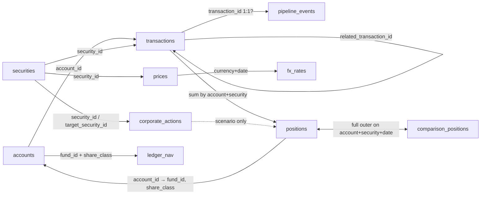

> **Note (12 Oct 2026):** this is our earlier team plan. For Check-in 1 we simplified the design to 3 offices, 6 handoffs, 7 checks and 7 KPIs, without ID codes, so the parts of this file about the "spine" workbook, IDs and 20 controls are out of date. Start with [`DELIVERABLES_GUIDE.md`](DELIVERABLES_GUIDE.md) for Check-in 1, and see [`RULES_DRAFT.md`](RULES_DRAFT.md) for the detailed rules. The Part Two plan below (code, rules file, timeline, why rules detect and AI explains) still applies.

# State Street Case: Team Overview

*BC Fall into BC Case Competition 2026 · "Data Quality in a Front-to-Back Investment Platform"*
*Written 9 Oct 2026 · Source of truth is always [`reference/01_Student_Brief.md`](../../reference/01_Student_Brief.md). If this file and the brief disagree, the brief wins.*

---

## 0. TL;DR

- **The job:** design how a fund platform should catch bad data *early*, then prove it on the supplied data. We find real defects, follow each one back to where it entered, and show where a control would have caught it sooner.
- **This is not just a detection tool.** Detection is 25% of the grade. Architecture is another 25%, and business recommendations are 20%. **The slide deck is the deliverable that counts most.**
- **Check-in 1 is Monday 12 Oct.** It covers architecture only and needs no data. See [Section 10](#10-plan-and-timeline) for what to bring.
- **Depth beats breadth.** Three defect types traced end to end, plus two "looked wrong but is fine" cases, beat a list of thirty.
- **Rules detect, AI explains.** Detection must be deterministic, reproducible code. AI is a helper on top, not the engine (see [Section 11](#11-should-we-build-a-multi-model-agent-rag)).

---

## 1. The problem in plain words

### The analogy

Think of a parcel passing through three warehouses:

1. **Front office**: the portfolio managers and traders. They decide what to buy and sell, and they **create** the trade.
2. **Middle office**: pricing and reconciliation analysts. They work out what each holding is worth and **check** that our records match the custodian's (the bank that physically holds the assets).
3. **Back office**: fund accounting. They keep the official ledger and calculate the **NAV** (the fund's price per share, which investors buy and sell at).

Every time data moves from one warehouse to the next (a **handoff**), it can be dropped, duplicated, delayed or changed. If a trade is booked twice at the front, it makes a wrong position, then a wrong valuation, then a wrong NAV, and investors trade at a wrong price.

### The flow and the five stages (brief §3–4)

```
account master + security master  →  transactions & corporate actions  →  positions  →  pricing & reconciliation  →  ledger, NAV & share classes
```

For the control map, the brief names **five stages**: **S1 Accounts · S2 Securities · S3 Transactions (incl. corporate actions) · S4 Positions · S5 NAV & ledger**. Pricing and reconciliation happen *between* positions and NAV, using **feeds** from outside: vendor prices, FX rates and the custodian's positions. Trades arrive through three source-system feeds (`OMS_FRONT`, `TRADE_CAPTURE`, `CUSTODY_FEED`). Our full shared list of stages, feeds, handoffs and owners (the "spine") is in [`CHECKIN1_WORK_SPLIT.md`](CHECKIN1_WORK_SPLIT.md).

The **master data** (accounts and securities) feeds every later stage. One bad master record contaminates everything downstream at once.

### Why "early" matters

The brief's whole thesis: **the cost of a defect rises with the distance between where it enters and where it is found.**

The industry shorthand for this is the **1-10-100 rule** (Labovitz & Chang, 1992). Preventing a bad record costs about 1, correcting it later costs about 10, and letting it cause a failure costs about 100. The numbers are illustrative, but the shape is the argument we are making.

### Mini glossary

| Term | Plain meaning |
|---|---|
| **NAV** (net asset value) | Fund assets minus liabilities, divided by shares. The price investors get. |
| **Position** | How many units of a security an account holds on a date. |
| **Break** | Two records of the same thing that should agree but don't. A break needs an explanation; it is not automatically an error. |
| **Reconciliation** | Comparing two sources (our book vs the custodian) and explaining every break. |
| **Corporate action** | An event at the issuer (split, merger, spin-off, redemption, dividend) that changes what holders own. |
| **Master data** | The reference records for *who* (accounts) and *what* (securities). |
| **Trade date / settlement date** | The day the deal is agreed / the day cash and securities are scheduled to change hands. |
| **Basis point (bp)** | 0.01%. On a $10bn fund, 1 bp = $1m. |
| **IBOR / ABOR** | Investment Book of Record (the up-to-date view the front and middle office use) vs Accounting Book of Record (the official back-office books). In this data, roughly `positions` vs `ledger_nav`. |
| **Control** | An automated or manual check placed at a stage, with an owner and a defined response when it fails. |
| **Data contract** | A written, *testable* promise from one office to the next ("every transaction has a valid account_id that is OPEN on trade date"). |

---

## 2. What our framing gets right, and what it misses

> "We need a detection and tracking tool that detects errors between the different offices, and a way to show the data flow."

That is about **half** the job. Here is how the grade is split (brief §9):

| Criterion | Weight | What it really means |
|---|---|---|
| Architecture, journey & detection model | **25%** | Control map, a real record traced end to end, "where could each defect be caught earliest", data contracts, operating model |
| Detection & reconciliation | **25%** | Defect catalog, transaction rebuild, position reconciliation, 3 traces + 2 clearances |
| Business insight & recommendations | **20%** | Who is affected, how much, what to fix first, who owns it, what it costs |
| KPI framework by office | 10% | Metrics front, middle and back office each recognise, rolling up to the Chief Data Officer |
| Dashboard & communication | 10% | Wireframes for 3 personas and 1 working executive view with drill-down |
| Reproducibility & honesty | 10% | One command reruns everything, stress tests, honest limitations, AI log |

The brief warns: *"a clever model with no owner, no threshold, and no case for why anyone should care does not clear the bar."*

**Every finding needs four things: a rule, an owner, a threshold, and a "so what".**

---

## 3. What we must deliver

### The 5 submission items (due week of 16 Nov; presentation Fri 20 Nov)

| Item | Limit | Notes |
|---|---|---|
| **Slide deck** (primary) | 12–15 slides + unlimited appendix | For a Chief Data Officer. Say it, show evidence, move on. |
| Written report | ≤ 8 pages + appendices | Starts with a 1-page executive summary. Formulas, defect catalog, indicator catalog. |
| Dashboard | — | 3 persona wireframes and 1 working executive view with drill-down to records. Local package, **no public hosting**. |
| Code & data package | — | Loads the full data and reruns everything. Environment versions, seeds, run command, runtime. No hard-coded defect IDs. |
| Team declaration & AI log | — | Who did what, plus the exported AI chat logs that shaped the work. |

**Presentation:** 15 min talk + 10 min Q&A. Everyone speaks. Expect "trace this record live" and "change this threshold and rerun".

### Requirement checklist

**Part One: Architecture (conceptual; Check-in 1)**
- [ ] Lifecycle & control map: **1 diagram** (5 stages × 3 offices, handoffs marked) and **1 table** (one row per control: what it checks, stage, failure response, owner role)
- [ ] For each stage: what must be true for data to leave it clean, which control proves it, who owns it
- [ ] End-to-end journey: 1 trade and 1 master record (account or security) traced through the tables, with IDs. Observed links kept separate from inferred ones. Missing evidence becomes a named missing data contract.
- [ ] **Detection-point model** (the core of Part One): for each defect family, the earliest stage it could be caught, the evidence needed, and the consequence of missing it
- [ ] KPI framework by office: formula, unit, owner, target, decision supported. **At least 6 quality dimensions**, and say why any obvious ones are excluded.
- [ ] Data contracts between offices, as testable conditions
- [ ] Operating model (1 page): ownership, prioritisation, remediation, prevention, accountability, plus a maturity path, walked through with one worked defect

**Part Two: Demonstration (data; Check-ins 2 & 3)**
- [ ] Profile and detect: defect catalog (how detected, count, confidence, how told apart from legitimate look-alikes)
- [ ] Position reconciliation: signed transaction rebuild, trade-date vs settlement-date variants, duplicate, status and reversal handling, full outer comparison with `comparison_positions`, differing, one-sided and unevaluable positions reported separately, corporate actions in a separate scenario with unsupported events quarantined
- [ ] Price data quality: coverage, freshness, vendor disagreement, unit or scale consistency
- [ ] Back-office integrity: `net_assets / shares_outstanding` vs `nav_per_share`
- [ ] Timeliness: feed latency, processing latency, cutoff adherence by feed and day. Missing, unparseable and out-of-order timestamps reported separately.
- [ ] "Why it matters": accounts, records and outputs affected, with exposure (not "loss"), and no double counting
- [ ] Detection-point analysis: where each defect entered, where we found it, and the earliest feasible control
- [ ] **≥ 3 defect classes traced back to origin, plus ≥ 2 flags cleared with evidence**
- [ ] Scorecard: account, domain and platform level. Formulas, weights, sensitivity. **≥ 6 indicators, ≥ 3 leading, ≥ 3 computed** (including 1 leading). Coverage shown next to every score.
- [ ] Dashboard (see above)
- [ ] Recommendations & roadmap tied to defect classes and their exposure
- [ ] Limitations: false positives and negatives, gaming risk, missing evidence
- [ ] Stress test: inject 1 new defect and 1 valid look-alike into a copy of the data, then report false positives and misses. Show that a **row-shuffle** leaves results unchanged.
- [ ] *(Optional)* Predictive risk indicator
- [ ] *(Optional)* AI-assisted monitoring

---

## 4. The data at a glance

Ten gzipped CSVs, about 82 MB compressed. Load everything as **text** first, then convert types on purpose (the README insists on this).

| Table | Rows | One row = | Stage / feed | Office |
|---|---:|---|---|---|
| `accounts` | 100,000 | one account | S1 Accounts (master data) | Front & back |
| `securities` | 6,012 | one security | S2 Securities (master data) | Middle |
| `transactions` | 1,409,533 | one trade record | S3 Transactions | Front → middle |
| `corporate_actions` | 200 | one issuer event (not per account!) | S3 Transactions | Middle |
| `pipeline_events` | 1,409,533 | timestamps for one transaction | S3 Transactions (lineage) | Front → middle |
| `positions` | 480,663 | account × security × date (our book) | S4 Positions | Middle |
| `comparison_positions` | 480,183 | account × security × date (custodian) | Feed F3, reconciled at S4 | Middle |
| `prices` | 539,970 | security × date × vendor (3 vendors) | Feed F1, values S4 → S5 | Middle |
| `fx_rates` | 180 | currency × date | Feed F2, values S4 → S5 | Middle |
| `ledger_nav` | 2,000 | fund × share class × date | S5 NAV & ledger | Back |

**Window:** 30 weekdays, 1 Jun to 10 Jul 2026. **Valuation snapshot:** 10 Jul 2026.

### How the tables join (our lineage map)



**Join rules from the Dataset Guide:**
- Never join on row order.
- Count rows before and after **every** join.
- Use `security_id` as the key; CUSIP is just a hint.
- Use full outer joins for reconciliation, so one-sided rows stay visible.
- Never silently turn "missing" into "zero".

---

## 5. What to look for

These are **questions to test**, taken from the brief, the Dataset Guide and the data dictionary. They are *not* confirmed findings. Nobody has told us what is actually wrong.

| Defect family | Where to test | Example check |
|---|---|---|
| Missing / invalid / colliding identifiers | `securities`, `transactions` | Same CUSIP on two `security_id`s? Trades referencing a `security_id` not in the master? |
| Incomplete onboarding | `accounts` | Blank `base_currency`, `domicile`, `fund_id`? |
| Closed accounts still trading | `accounts` × `transactions` | `trade_date > close_date` or status ≠ OPEN |
| Duplicated transactions | `transactions` | Same `transaction_id` twice; or identical economics (account, security, date, qty, price) under different IDs |
| Orphan cancels / reversals | `transactions.related_transaction_id` | Link points to nothing, to itself, or to the wrong account or security |
| Bad values | `transactions` | Negative raw quantity, `gross_amount ≠ quantity × price`, nulls |
| Mixed formats | all date columns | ISO `YYYY-MM-DD` and `DD/MM/YYYY` both present; unparseable strings |
| Settlement rule breaches | `transactions` | `settlement_date < trade_date`, or unusually long gaps (check `settlement_note` before calling it an error) |
| Positions ≠ history | `positions` vs rebuilt trades | Rebuilt quantity ≠ reported quantity; `transaction_count` mismatch |
| Our book ≠ custodian | `positions` vs `comparison_positions` | Differing quantities and one-sided keys |
| Corporate actions applied unevenly | `corporate_actions` | Missing target security, `ex_date` after `effective_date`, unsupported terms |
| Stale / disputed prices | `prices` | Missing quotes, old `price_timestamp`, vendors disagreeing, a bond quoted at 100 vs 1.00 (percent-of-par vs unit scale) |
| Currency conflicts | `prices`, `securities`, `fx_rates` | Price currency ≠ security currency; missing FX rate |
| Late / out-of-order processing | `pipeline_events` | booked < received, published after cutoff, missing timestamps |
| Ledger arithmetic | `ledger_nav` | `net_assets / shares_outstanding ≠ nav_per_share` |

**Legitimate look-alikes (do not over-flag):**
- negative holdings, which can be shorts
- unchanged prices, which can be genuinely flat
- a settlement delay with an agreed extension note
- a BOOKED rebook linked to a CANCELLED original

To clear a flag you need a **stated rule** and **independent evidence from another field or table**. A record can't vouch for itself.

**Three evidence statuses for every flag:** `confirmed`, `unresolved` (plus what data would settle it), `cleared` (plus the evidence).

---

## 6. How professionals do this

The brief rewards teams that connect disciplines (Appendix C). Here is what each industry idea gives us. Use each as a *lens*, not as a claim about State Street's systems.

| Practice | What it is | How we use it |
|---|---|---|
| **Reconciliation & break management** | Banks auto-match two sources within a tolerance, then work the leftover "breaks": age them, classify a root cause, escalate old or large ones. Commercial tools include Duco, Gresham and SmartStream TLM. ISDA publishes reconciliation best practice. | Our position recon: break classes, aging (trade vs settlement date), root cause, owner |
| **DAMA data-quality dimensions** | Six core dimensions: completeness, uniqueness, validity, consistency, timeliness, accuracy. The working guide adds referential integrity and conformity, for 8. | The "≥ 6 dimensions" requirement and the structure of our KPI table |
| **BCBS 239** | Basel Committee principles (2013) for bank risk data. Data must be accurate, complete and timely, with **lineage** (traceable from origin to report). | Justifies the end-to-end trace and the "where did it enter" question |
| **Data contracts** | Machine-readable promises between producer and consumer (schema, quality rules, SLA, owner). Open standard: **ODCS v3.1** (Bitol, Linux Foundation). | Write our office-to-office contracts as testable rules, ideally in YAML |
| **Data observability** | Automatic monitoring of freshness, volume, schema changes and distribution shifts | Leading indicators (volume drop per feed, latency drift) |
| **Lineage standards** | **OpenLineage** (with Marquez as the reference server) records which job read and wrote which dataset | Concept for our journey diagram. Too heavy to deploy here. |
| **Maturity models** | **EDM Council DCAM**: five maturity levels from ad hoc to optimised | Our "maturity path" slide |
| **NAV error thresholds** | Regulators define when a NAV error is "material". Example: Luxembourg **CSSF Circular 24/856**: 0.2% money market, 0.5% bond and mixed, 1% equity funds. | An *external reference point* for materiality. **Label it as such: not a sponsor SLA and not State Street policy.** |
| **Knowledge graphs** | Model accounts, securities and positions as a network to see how far one bad record spreads | Optional "blast radius" view (Appendix C) |

---

## 7. Recommended tools

The team is comfortable with Python and SQL, so we keep everything in **Python + DuckDB** and run it all with one command.

| Need | Tool | Why |
|---|---|---|
| Query engine | **DuckDB** | SQL directly on `.csv.gz`, handles 1.4M rows on a laptop in seconds, no server. Use `read_csv(..., all_varchar=true)` to load as text. |
| DataFrames | **Polars** (or pandas) | Fast glue code. Pandas is fine if the team knows it better. |
| Schema / type checks | **Pandera** | Lightweight checks inside our own code. *Great Expectations* or *Soda* are heavier alternatives; not needed here. |
| Rule catalog | **YAML file + SQL files** | One entry per check: id, stage, dimension, owner, threshold, severity, failure action. Scores read their config from this file (the "metadata-driven scoring" idea in Appendix C), and **judges can change a threshold live**. |
| Executive dashboard | **Streamlit + Plotly** | A working drill-down from platform → domain → account → record in a few hundred lines. Runs locally. |
| Data flow visual | **Plotly Sankey** | Records flowing through the stages, with a branch for "flagged here" at each one |
| Blast radius (optional) | **NetworkX** (+ pyvis) | Graph of account ↔ security ↔ fund; count what one bad record touches |
| Diagrams | **Excalidraw**, **draw.io**, or **Mermaid** | Control map and journey for Check-in 1. Mermaid lives in markdown and git. |
| Persona wireframes | **Excalidraw** or **Figma** | The brief wants sketches, not software, for the 3 office personas |
| Tests | **pytest** | Stress-test fixtures (injected defect + look-alike), row-shuffle test, row-count checks |
| Reproducibility | **uv** (or conda) lockfile + `make all` / `python run_all.py` | One command regenerates every number on the slides; record runtime and versions |
| Version control | **Private** GitHub repo | Never push data to a public repo. Keep `data/` out of any public fork. |

**Proposed repo layout**

```
data/                 raw, read-only (never edited)
docs/                 this file, architecture, contracts
config/
  rules.yaml          rule catalog (id, stage, owner, threshold, severity, action)
  params.yaml         tolerances, vendor priority, settlement-lag assumption
src/
  ingest.py           load as text, parse, keep parse failures, row ledger
  profile.py          dimension checks per table
  reconcile.py        transaction rebuild, recon vs book and custodian
  prices.py  ledger.py  timeliness.py  corp_actions.py
  score.py            account / domain / platform scores + coverage
  trace.py            record-level journey for any ID
outputs/              generated CSV / parquet / JSON (gitignored)
dashboard/app.py      Streamlit executive view
tests/fixtures/       stress-test copies (kept separate)
ai_log/               exported AI conversations
run_all.py            one command → all outputs
```

**Example rule entry**

```yaml
- id: TXN_ACCOUNT_NOT_OPEN
  stage: transactions
  handoff: front_to_middle
  dimension: validity
  check: trade_date outside [open_date, close_date] or account status != OPEN
  owner: Account onboarding lead
  on_fail: hold_trade
  threshold: 0          # any occurrence
  severity: high
  indicator_type: leading
```

---

## 8. Showing the data flow

We visualise the flow at four levels, from big picture to a single record:

| Level | Visual | Tool | Answers |
|---|---|---|---|
| **A. Platform map** | 5 stages × 3 offices, arrows at every handoff, a control symbol on each arrow | Excalidraw / Mermaid | "Where do controls sit and who owns them?" (Check-in 1) |
| **B. Volume flow** | Sankey: 1.4M transactions → valid → matched to a position → reconciled → in NAV, with a "flagged" branch at each stage | Plotly | "Where does data fall out, and how much?" |
| **C. Record trace** | Click one ID and see each hop with its actual fields | Streamlit table | "Prove this defect: where did it enter?" (Q&A will ask live) |
| **D. Blast radius** *(optional)* | Graph from one bad security to all positions, accounts and funds it touches | NetworkX | "How big is the damage of one bad master record?" |

**Record trace format** (from the working guide). Mark every link as **observed** (a real key match in the data) or **inferred** (our reasoning).

| Hop | Record & key fields | What the evidence shows | Control that would have caught it |
|---|---|---|---|
| Source | `transactions` row: transaction_id, account_id, security_id, status, source_system | What was sent, by which system, when | Capture-time validation |
| Pipeline | `pipeline_events`: received, booked, published, cutoff, batch_id | Was it on time, and in order? | Timeliness gate |
| Master data | `accounts` / `securities` row | Was the account open, was the security mastered? | Reference-data gate |
| Position | `positions` + rebuilt quantity + `comparison_positions` | How it moved the holding; book vs history vs custodian | Rebuild-and-compare |
| Downstream | `ledger_nav` for that fund_id + share_class | Which NAV it could reach | Pre-NAV-strike check |
| Gap | — | Where the evidence stops | **Name the missing data contract** (e.g. a per-account corporate-action posting log) |

**Starter query to pull a real journey** (swap in an ID):

```sql
-- duckdb, run from the repo root
WITH t AS (SELECT * FROM read_csv('data/transactions.csv.gz', all_varchar=true)
           WHERE transaction_id = 'PUT_ID_HERE')
SELECT t.*, p.received_timestamp, p.booked_timestamp, p.published_timestamp, p.cutoff_timestamp, p.batch_id,
       a.fund_id, a.share_class, a.status AS acct_status, a.close_date,
       s.cusip AS master_cusip, s.asset_class, s.currency AS sec_ccy
FROM t
LEFT JOIN read_csv('data/pipeline_events.csv.gz', all_varchar=true) p USING (transaction_id)
LEFT JOIN read_csv('data/accounts.csv.gz',        all_varchar=true) a USING (account_id)
LEFT JOIN read_csv('data/securities.csv.gz',      all_varchar=true) s USING (security_id);
```

Use `LEFT JOIN` so a missing link shows up as NULL instead of disappearing. Then look up the matching `positions`, `comparison_positions` and `ledger_nav` rows by account, security and fund.

---

## 9. Measuring: KPIs and scorecard

- **KPI = metric + formula + unit + owner (a role) + target + the decision it supports.** Without an owner and a target, it is just an observation. Appendix A of the brief shows the expected detail.
- Label every metric **computed** (from this data), **simulated** (on injected test data), or **proposed** (needs data we don't have, so name that data).
- Always publish the **denominator**, and report missing or unevaluable records separately. Missing data must never make a score look better.
- **Scores:** account → domain (accounts, securities, transactions, positions, prices, NAV) → platform. Use weighted pass rates, show coverage next to each score, and run a sensitivity check on the weights.
- **Leading vs lagging:**
  - *Leading* indicators warn early: unmastered-security rate, corporate-action readiness, booking latency.
  - *Lagging* indicators confirm damage afterwards: break count, NAV restatement.
  - We need ≥ 3 leading indicators.
- **Owners are roles:** account onboarding lead, security master lead, trade operations lead, pricing lead, reconciliation lead, fund accounting lead, Chief Data Officer.

---

## 10. Plan and timeline

### This weekend → Check-in 1 (Mon 12 Oct): architecture

Bring the following. Templates are below each item. **Who does what, and the shared "spine" we build first, are in [`CHECKIN1_WORK_SPLIT.md`](CHECKIN1_WORK_SPLIT.md).**

**1. Control map diagram.** Five stages as columns, three offices as rows, arrows for every handoff, and a control on each arrow.

**2. Control table** (one row per control)

| Control | Checks | Stage | On failure (reject / hold / flag / correct) | Owner |
|---|---|---|---|---|
| Account status gate | Account is open on the trade date | Transactions | Hold the trade; route to onboarding | Account onboarding lead |
| *…one row per control…* | | | | |

**3. Detection-point model** (the core of Part One). These are starter rows; refine them as a team.

| Defect family | Earliest stage to detect | Evidence needed | If missed until next stage… |
|---|---|---|---|
| Missing / invalid identifier | Security master (on creation) | ID format, uniqueness, cross-ID consistency | Trades can't be priced; position and NAV gaps |
| Duplicated transaction | Transaction capture | Unique ID + economic-duplicate key | Position overstated, so valuation and NAV overstated |
| Late record | Pipeline (receipt vs cutoff) | received / booked / cutoff timestamps | Misses NAV cutoff, so NAV is stale |
| Stale / disputed price | Pricing (pre-selection) | Timestamp age, cross-vendor spread | Wrong valuation goes straight into NAV |
| Corporate action applied unevenly | Corporate-action intake (before effective date) | Complete terms, valid target, list of holders | Positions wrong for some accounts only |
| Position ≠ history | Position (rebuild vs reported) | Full transaction history, status rules | Breaks with the custodian; wrong holdings shown to the PM |

**4. Draft KPI table:** at least 2 per office plus an executive roll-up. Columns: metric, formula, unit, owner, target, *decision it supports* (one sentence each).

**5. Draft data contracts.** For example: *"Front → Middle: 100% of transactions have an account_id that exists in the account master and is OPEN on trade_date; breach = any row; measured daily."*

**6. Journey sketch:** one trade and one security (or account) master record. Grounding it with a real ID from the starter query in [Section 8](#8-showing-the-data-flow) costs about 30 minutes and impresses.

### 12 → 19 Oct → Check-in 2: method gate
- Ingest everything as text and parse explicitly, with a **row ledger** (rows in and out for every step).
- Profile every table against the 8 dimensions.
- Transaction rebuild with a BOOKED-only baseline and zero opening balance, then trade-date vs settlement-date variants.
- Reversal interpretations, compared side by side: REVERSED = inactive state vs offsetting event. Prevent double offsets.
- Full outer reconciliation: rebuild vs `positions`, and `positions` vs `comparison_positions`.
- First break classification and draft defect catalog. Use the 7-field template from Working Guide §6: name & status, rule, population, example IDs, where it entered, why it matters, fix.
- Corporate-action readiness, with unsupported events quarantined.

### 19 Oct → 9 Nov → Check-in 3: full build
- 3 traced defects + 2 evidenced clearances
- Price, ledger-arithmetic and timeliness checks
- Exposure: accounts affected, notional, bp of NAV (labelled as exposure, not loss)
- Scorecard + indicators; Streamlit executive view with drill-down; persona wireframes
- Stress test (inject 1 defect + 1 look-alike) and row-shuffle test
- Roadmap and operating model with one worked defect
- Full slide draft

### 9 → 16 Nov: polish
- Clean rerun from scratch and record the runtime
- Report ≤ 8 pages
- Deck rehearsal: every member can explain every number
- Export the AI log

### Roles for our 5-person team

For Check-in 1, the detailed split is in [`CHECKIN1_WORK_SPLIT.md`](CHECKIN1_WORK_SPLIT.md). After that, each person carries on in the area closest to their Check-in 1 piece. This is a suggestion; we rebalance at Check-in 2 if needed.

| Person | Check-in 1 piece | From Check-in 2 on |
|---|---|---|
| **A**: Architect / integrator | Control map + control table | Storyteller: deck storyline, report, roadmap, keeping Part One and Part Two consistent |
| **B**: Detection lead | Detection-point model | Recon analyst: transaction rebuild, reconciliation, corporate actions, defect traces |
| **C**: Data person | Data journey | Data engineer: ingest, row ledger, rule catalog, `run_all.py`, stress and shuffle tests |
| **D**: Metrics lead | KPI table | Dashboard / KPI lead: scorecard, indicators, Streamlit executive view, wireframes |
| **E**: Contracts & operating model | Data contracts + operating model | Pricing, NAV & timeliness analyst: price checks, FX, ledger arithmetic, pipeline latency, plus the operating model with a real worked defect |

---

## 11. Should we build a multi-model agent RAG?

**Short answer:** not as the detection engine. Yes as a small, well-fenced helper on top.

### Why it shouldn't be the core

| Issue | Why it matters here |
|---|---|
| **RAG fits documents, not tables** | RAG retrieves passages of text. Our problem is joins and arithmetic over 1.4M rows, which SQL does exactly and instantly. |
| **Nondeterminism** | The same prompt can give different answers. The rubric gives 10% to reproducibility, and judges **rerun our code on test fixtures** and **change thresholds live**. |
| **Arithmetic and over-flagging** | LLMs are weak at exact sums. The Working Guide explicitly warns that AI "makes the call confidently and sometimes reverses it", over-flags, and silently drops rows. |
| **Every flag needs rule + owner + threshold + trace** | "The model thought it looked odd" is not a defensible control. The brief says so directly. |
| **More models ≠ more truth** | An ensemble of LLMs adds cost and complexity but doesn't make the output auditable. |
| **Q&A risk** | "Why did your system flag this?" needs a one-line rule answer, not "the agent decided". |

### Where AI genuinely helps

- **Optional "AI-assisted monitoring" (brief §5):**
  - plain-language summaries of what changed on the dashboard
  - anomaly detection on metric time series (e.g. latency per feed per day)
  - suggested thresholds
- **Drafting** finding write-ups and exec-summary text from our defect catalog.
- **Hypothesis generation** for unexplained breaks ("check whether these share a batch_id"), always verified by code.
- **Coding assistant** for SQL, tests and the Streamlit app.
- **A Q&A helper** over the brief and guides. This is where RAG *does* fit, because those are documents.

### Recommended pattern: "rules detect, AI explains"

```
deterministic engine (DuckDB + rules.yaml)  →  outputs/defects.json  (rule id, record ids, counts, exposure)
                                                     ↓
                     one LLM step: "summarise for the CDO; cite record IDs"
                                                     ↓
                code check: every ID or number the LLM cites must exist in defects.json → otherwise reject
                                                     ↓
                          plain-language panel on the dashboard (labelled "AI-generated")
```

- Do this **after** the core analysis works (Check-in 3 at the earliest), and time-box it.
- One good model is enough. Log every prompt and response; that becomes part of the required AI log.
- **Confirm in writing** with the organisers which AI tools may receive the data. The brief (§10) says "university-approved tools" and "no public AI links". Even if any tool is fine, having that confirmation protects us.

---

## 12. Resources

**Case documents (read in this order):** [Student Brief](../../reference/01_Student_Brief.md) · [Dataset Guide](../../reference/02_Dataset_Guide.md) · [Working Guide](../../reference/03_Student_Working_Guide.md) · [data_dictionary.csv](../data_dictionary.csv) · [load_data.ipynb](../load_data.ipynb)

**Industry practice**
- ISDA: [Portfolio Reconciliation Best Operational Practice](https://www.isda.org/attachment/MjIyNw==/Portfolio_Reconciliation_Best_Operational_Practic)
- Gresham: [break investigations and root cause](https://www.greshamtech.com/blog/how-integrating-research-and-reconciliation-data-accelerates-break-investigations)
- BIS: [BCBS 239 principles & implementation](https://www.bis.org/publications/implementation-principles-effective-risk-data-aggregation-and-risk-reporting-bcbs-239-principles) · [Jan 2026 newsletter](https://www.bis.org/publ/bcbs_nl36.htm)
- UK Government: [the six data quality dimensions (DAMA UK)](https://www.gov.uk/government/news/meet-the-data-quality-dimensions) · IBM: [data quality dimensions](https://www.ibm.com/docs/en/DSXDOC/wsj/quality/dq-dimensions.html)
- Bitol: [Open Data Contract Standard (GitHub)](https://github.com/bitol-io/open-data-contract-standard) · [ODCS v3.1 announcement](https://bitol.io/bitol-announces-odcs-v3-1-0-stronger-smarter-and-stricter/)
- [OpenLineage getting started](https://openlineage.io/getting-started)
- EDM Council DCAM: [overview (Snowflake)](https://www.snowflake.com/en/fundamentals/data-governance/framework/dcam/)
- CSSF Circular 24/856 on NAV errors: [Dechert summary](https://dechert.com/knowledge/onpoint/2024/4/new-cssf-circular-on-nav-errors-and-investment-rule-breaches.html) · [Clifford Chance briefing](https://www.cliffordchance.com/content/dam/cliffordchance/briefings/2024/04/cssf-circular-24.pdf)
- 1-10-100 rule: [Loqate explainer](https://loqate.com/en-gb/blog/the-1-10-100-rule-the-real-impact-of-poor-data)

**Tools:** [DuckDB](https://duckdb.org/docs/) · [Polars](https://docs.pola.rs/) · [Pandera](https://pandera.readthedocs.io/) · [Streamlit](https://docs.streamlit.io/) · [Plotly Sankey](https://plotly.com/python/sankey-diagram/) · [NetworkX](https://networkx.org/) · [Mermaid](https://mermaid.js.org/) · [Excalidraw](https://excalidraw.com/) · [Great Expectations](https://docs.greatexpectations.io/) · [Soda](https://docs.soda.io/) · [DQ tools compared, 2026](https://getbruin.com/blog/best-data-quality-tools-2026/)

**Optional public reference data (brief §6).** Document what we pull and when.
- [GLEIF LEI data](https://www.gleif.org/)
- [OpenFIGI](https://www.openfigi.com/)
- [ISO 4217 currencies](https://www.iso.org/iso-4217-currency-codes.html)
- [ISO 10383 exchange codes (MIC)](https://www.iso20022.org/market-identifier-codes)
- [SEC EDGAR](https://www.sec.gov/)

**AI in financial data, with limits**
- Altruist: [automating data operations with AI agents](https://altruist.com/engineering-blog/automating-data-operations-with-claude-ai-agents/)
- Amazon Science: [multi-agent root-cause analysis of financial discrepancies](https://assets.amazon.science/69/cb/d93876ef4ce5b8c2a2a07087b261/beyond-detection-a-multi-agent-framework-for-root-cause-analysis-of-financial-discrepancies-in-distributed-environment.pdf)
- Preprint: [deterministic fact ledgers vs LLM hallucination in finance](https://arxiv.org/pdf/2603.04663)

*External figures above are references, not sponsor targets. The brief forbids presenting invented benchmarks, so label every external number with its source.*

---

## 13. Open questions for organisers / check-ins

1. Which AI tools are approved for use with the synthetic data? (Get it in writing.)
2. May the Check-in 1 journey already use real record IDs, or should it stay illustrative?
3. Preferred dashboard packaging: a zipped Streamlit app with a `requirements.txt`, or something else?
4. Any preferred settlement-lag assumption, or is it fully the team's call (the Dataset Guide implies ours)?
